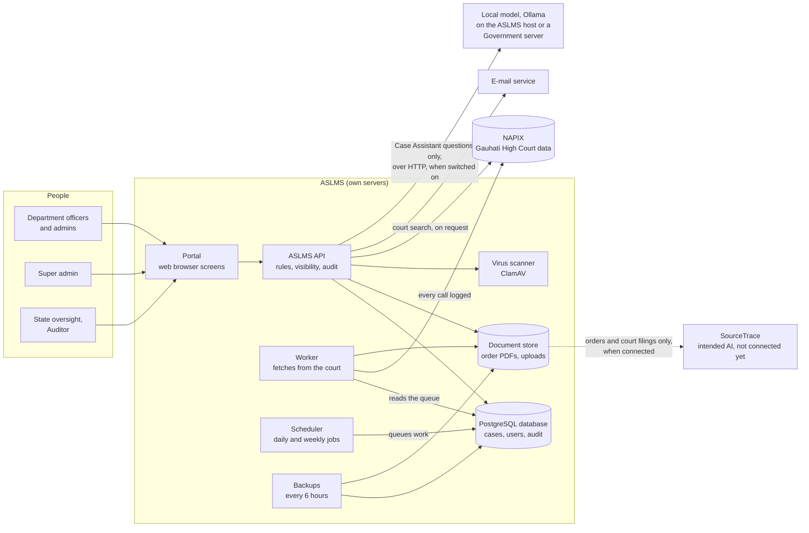
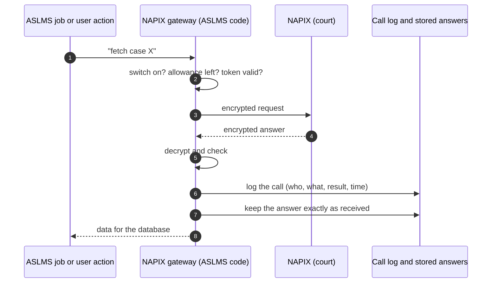
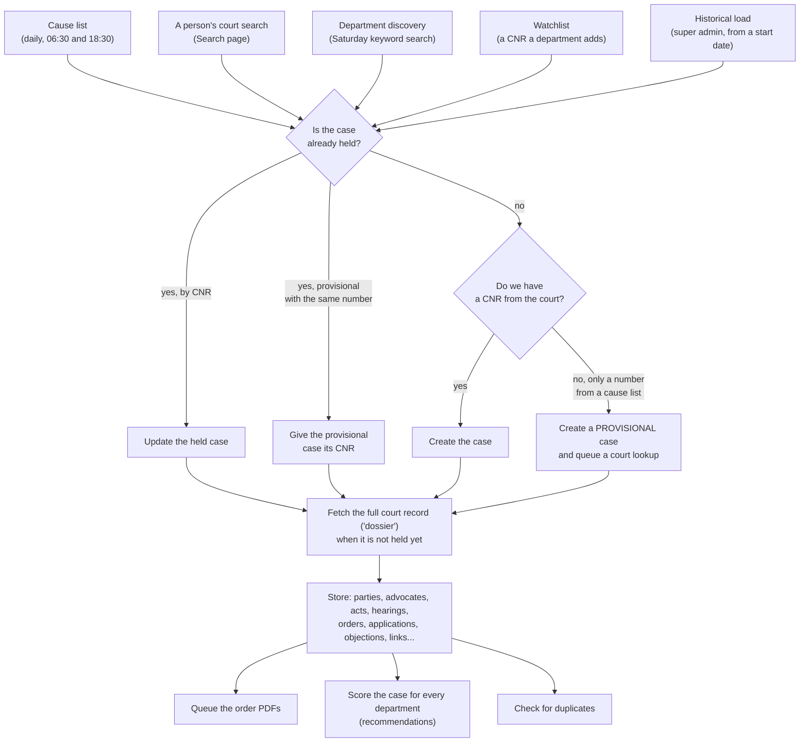
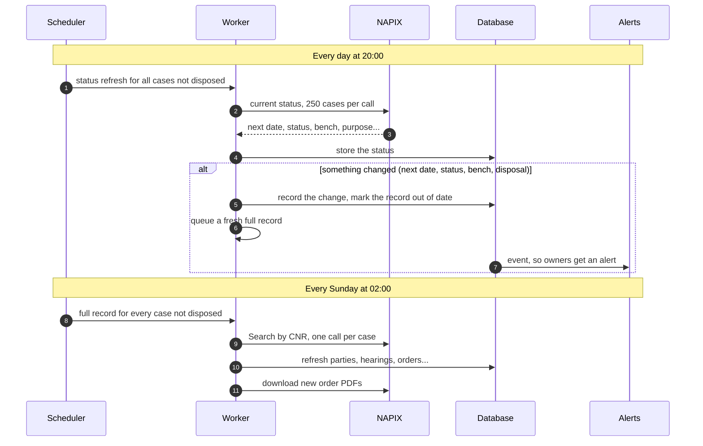
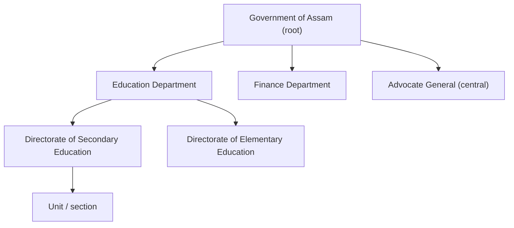
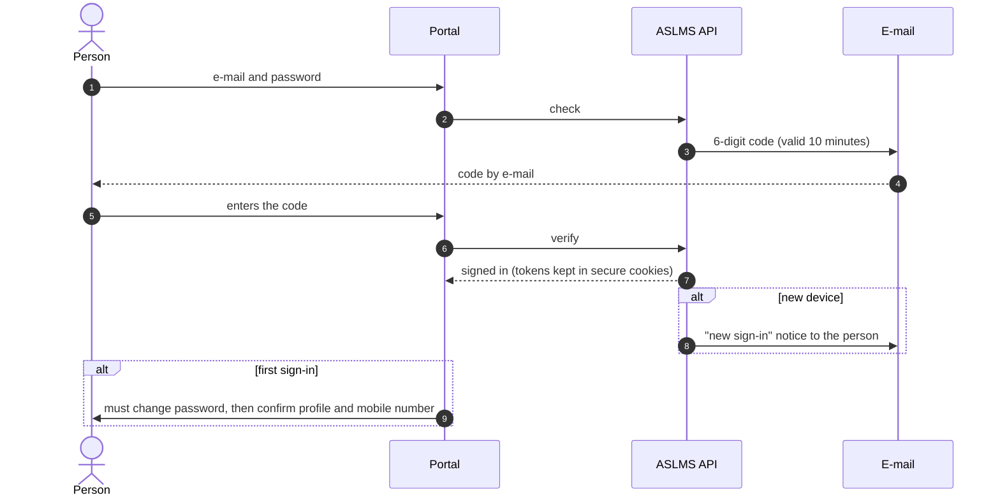
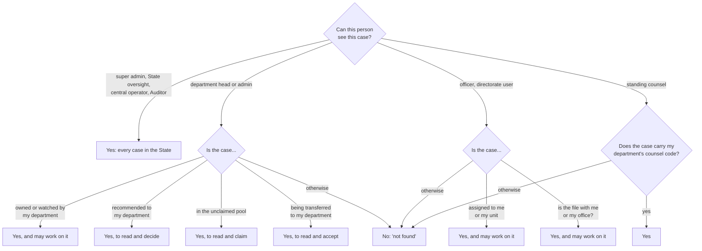
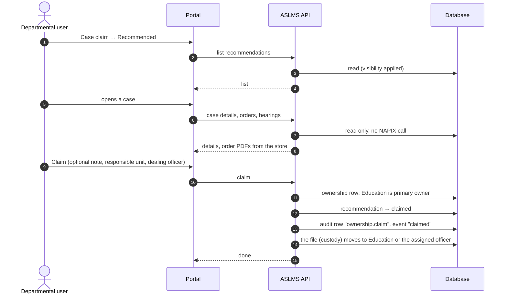
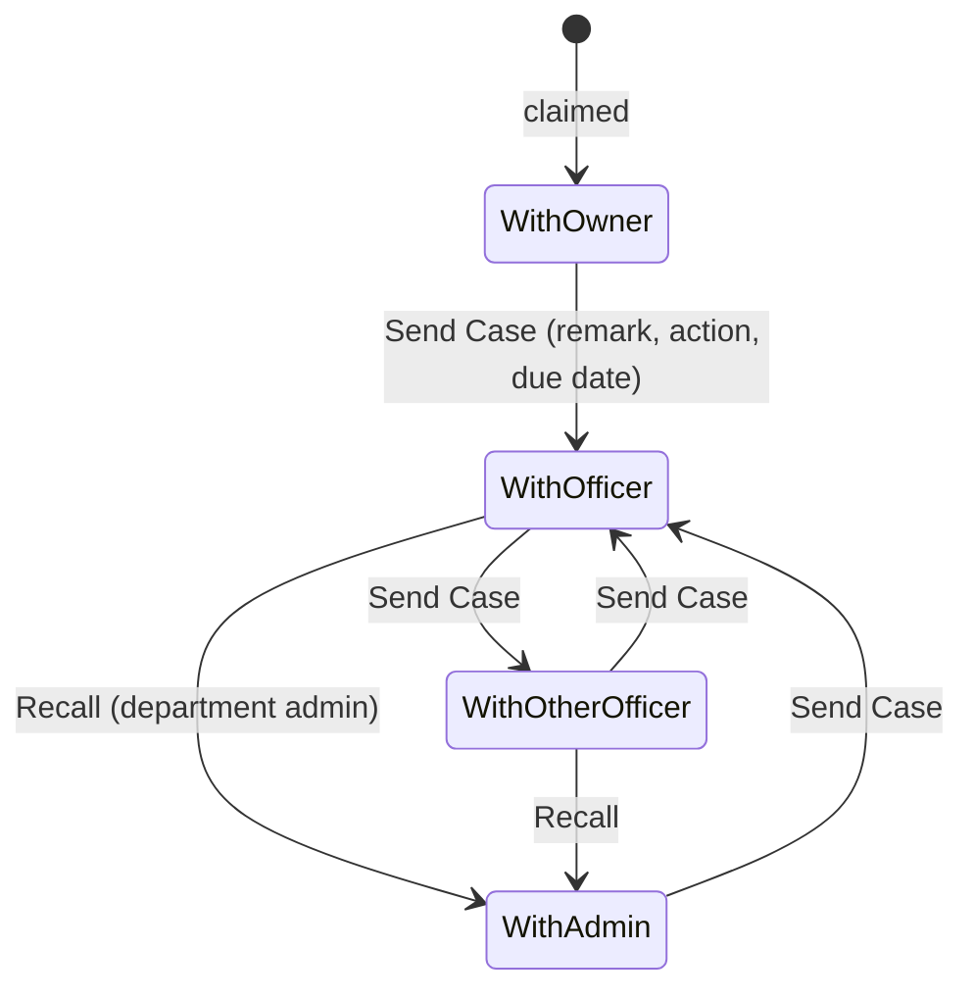
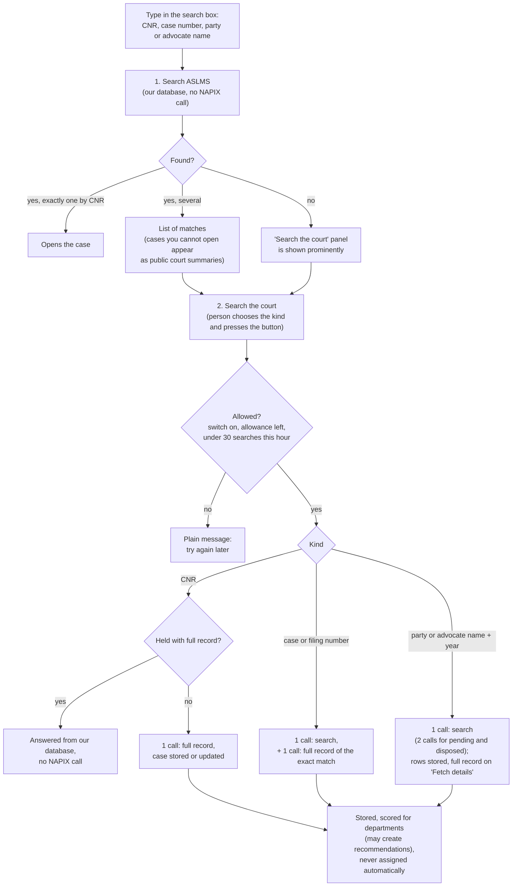

# ASLMS: how the system works

**Assam State Litigation Management System: process workflows and data handling**

| | |
|---|---|
| Owner | Government of Assam |
| Describes | The system as built on `main`, 21 October 2026; the court-call slots, renewals, State-plus-department remarks and the no-local-model guard of row 137, 24 October 2026; court data freshness (section 2, items 10 to 12 of section 6) as changed on 24 October 2026; the Case Assistant in preview mode (sections 4.9 and 5), 24 October 2026; and, as built on `main` on 28 October 2026 (rows 135 to 190): the single Case inbox, the Administration hub and Title Case labels, the Office Picker and Filter Layout B, the sixth scoring weight for partial counsel codes (4.1), case numbers on the court's code (2.3), the head of a department chosen from existing logins and a login with no office (3.1), "Assign" in place of "Allot" throughout, the Data Collection tabs (2.5), the next hearing badge (4.5), search and sort on lists (4.2, 4.4), the session timeout (3.3, 5, 6) and the Case Assistant answered by a local model (1, 4.9, 5) |
| Readers | The product owner, department and State officials, auditors and anyone asked how ASLMS handles data |
| Status | Living document: updated when a workflow changes |

This document describes what the software **actually does today**. It was written from the code, not from the
plan. Where the code and the plan differ, the code is described and the difference is marked.

How to read it:

- Sections 1 and 2 explain where the data comes from and how it is kept up to date.
- Section 3 explains users, sign-in and who can see what.
- Section 4 walks through the work of each kind of user, step by step.
- Section 5 is a one-page summary of data handling, for questions from officials and auditors.
- Section 6 lists the behaviours worth a decision now. Change them before the pilot if you want them to work differently.

Two kinds of boxes appear throughout:

> ⚙️ **You can change this:** a setting the super admin can change in the application, or a default that is easy
> to change.

> ⚠️ **Worth a decision:** the system works this way today, and it may not be what you expect. Each one is
> repeated in section 6.

---

## Contents

1. [The big picture](#1-the-big-picture)
2. [Where the data comes from: NAPIX](#2-where-the-data-comes-from-napix)
3. [Users, sign-in and who can see what](#3-users-sign-in-and-who-can-see-what)
4. [Walk-throughs by user type](#4-walk-throughs-by-user-type)
5. [Data handling at a glance](#5-data-handling-at-a-glance)
6. [Points worth a decision](#6-points-worth-a-decision)
7. [Glossary](#7-glossary)

---

## 1. The big picture

ASLMS helps Assam government departments track their cases before the Gauhati High Court. The court's data comes
from the **NAPIX** APIs, the official eCourts / High Court interface. ASLMS stores that data in its own database.
Departments then **claim** the cases that are theirs, move the file between officers, write notes, upload filings,
and get alerts before hearings.

### The rules the system never breaks

| Rule | What it means in practice |
|---|---|
| **Recommend and claim** | The system only *recommends* a case to a department. A case belongs to a department only after a person in that department claims it. Once claimed, it never goes back to the unclaimed pool. |
| **NAPIX only through one gateway** | Every call to the court goes through one part of the code. That part handles encryption, the access token, retries and the hourly allowance, and it logs every call. A failed call is recorded, never lost. |
| **A master switch for NAPIX** | `NAPIX_ENABLED` is off by default. Nothing calls the court unless an operator switches it on when the services start. |
| **Every court answer is kept** | Each answer from NAPIX is stored exactly as received, and every field also has a proper place in the database. |
| **No made-up identifiers** | A CNR always comes from the court. A case known only by its number, for example from a cause-list line, is *provisional* until the court confirms its CNR. |
| **Visibility on the server** | The server decides what each person may see, for every request. Hiding something on screen is never the protection. |
| **Notes are append-only** | A note is never edited or deleted. A correction is a new note linked to the old one. |
| **Legal records are never deleted** | Cases, orders, documents and notes are kept. Documents can be archived, not deleted. |
| **Everything significant is audited** | Ownership decisions, file movements, notes, uploads, user and configuration changes all write an audit row. |
| **All AI through the Case Assistant connector** | SourceTrace is the intended AI (plan, row 36) and is not connected yet. Only court orders and uploaded court filings may ever go to SourceTrace, never notes or internal documents. **Difference from the plan (owner's decision, 27 October 2026):** until SourceTrace is available, Case Assistant questions may be answered by **one local model served by Ollama** on the ASLMS host or a server the Government controls, reached over HTTP only through `backend/aslms/integration/ollama/`. It is allowed in production, for Case Assistant questions only. There is **no cloud AI service and no cloud model**, and **no model, model runtime or model library inside ASLMS's own programs**: the system checks this, and if an AI runtime (onnxruntime or a PyMuPDF layout package) ever appears in the installed software it refuses to start, in every environment. What the local model may read is set out in section 4.9. |

---

## 2. Where the data comes from: NAPIX

### 2.1 How ASLMS talks to the court

ASLMS never scrapes the court website. All court data comes from the NAPIX APIs, through one gateway in the code
(`backend/aslms/integration/napix/`).

- **Access token.** ASLMS signs in to NAPIX with its own credentials, which are kept only in the server's `.env`
  file. It receives a token that lasts about 55 minutes. One token is shared by every part of ASLMS and renewed
  shortly before it expires. If NAPIX rejects a token, ASLMS renews it once and repeats the call. A renewal is not
  a failure: it is kept in the call counts and the hourly allowance, but it is left out of every failure count (the
  data-health screen, the data-health report and the monitoring alert).
- **Encryption.** Every request and answer is encrypted the way NAPIX requires.
- **Retries.** If the court's server is busy, a call is tried up to three times with short pauses. Work that still
  fails goes back to the queue (section 2.6).
- **The call log.** Every attempt is a row in `napix_call_log`: which API, when, how long, success or failure, the
  error, and **the user whose action caused it**. Background work records no user.
- **Answers kept as received.** Every successful answer is stored exactly as received in `napix_responses`. Order and
  cause-list PDFs go to the document store.

**The hourly allowance.** NAPIX allows ASLMS about 1,000 calls per hour. The hour does not start on the clock hour,
so ASLMS works out when it resets from its own call log. It keeps a reserve so that people's searches are not
blocked by background work:

| Calls left in the hour | What may run |
|---|---|
| 150 or more | Everything, including the historical load and discovery |
| 100 to 149 | Only people's requests and the daily cycle |
| Fewer than 100 | Nothing from the queue; the worker waits for the reset |
| Fewer than 50 | A person's court search is refused with "try again shortly" |

**Many searches at once.** ASLMS makes at most 6 court calls at a time for people's requests (the slots). When all
slots are busy, a person waits up to 20 seconds, and then sees "the court service is busy, try again shortly". That
refusal writes nothing and is not counted against the person's hourly limit of 30 searches. Waiting holds no
database connection, and the record of each call is written on a small connection pool of its own, so a burst of
searches can no longer lose call rows.

> ⚙️ **You can change this:** the reserves (`NAPIX_RATE_RESERVE`, `NAPIX_LIVE_RESERVE`, `NAPIX_SEARCH_FLOOR`) and
> each person's limit of 30 court searches an hour are settings in `.env`, as are the slots (`NAPIX_REQUEST_SLOTS`)
> and the wait (`NAPIX_REQUEST_WAIT_SECONDS`).

### 2.2 The daily and weekly rhythm

The **scheduler** decides *when* work happens and puts it in a queue. The **worker** does the actual fetching from
NAPIX. All times are Indian Standard Time.

| When | Job | What happens | Calls NAPIX? |
|---|---|---|---|
| 06:00 daily | Court masters | Refreshes the court's reference lists: states, districts, benches, case types, acts | Yes |
| 06:30 and 18:30 daily | Cause lists | Fetches the lists for yesterday, today and tomorrow: benches, list details, the list PDFs. Reads each PDF and records every entry. | Yes |
| 18:30 daily (and 06:30 for today's lists) | Cause list re-check | Asks the court again for each list already held for today and tomorrow (at 06:30, today only). A list whose entries changed is kept as a new version (section 2.3). | Yes |
| 20:00 daily | Status refresh | Asks the court for the current status of every case not yet disposed, 250 cases per call | Yes |
| Every 5 minutes | Order text | Reads the text of newly stored order PDFs and uploads | No |
| Every 5 minutes | Next dates | Reads "list on…" directions in order text (section 4.5) | No |
| Every 5 minutes | Alerts | Turns new events (new order, file received…) into alerts | No |
| Every hour at :10 | Date alerts | Hearing reminders, due and overdue actions; closes alerts whose date has passed | No |
| Every 2 minutes | E-mail | Sends alert e-mails | No |
| 08:00 daily | Digest | Builds and sends each person's daily summary e-mail | No |
| Every 15 minutes | Rescore | Recalculates recommendations, but only if mapping rules or scoring settings changed | No |
| 03:00 daily | Duplicates | Finds and merges duplicate case records | No |
| 02:30 daily | Disposed cases | Queues a full record for each disposed case within a year of its disposal whose last refresh is more than 28 days old, at most 1,000 a night (section 2.4) | Yes |
| 03:45 daily | Call log purge | Removes call-log rows older than 2 years (section 2.7) | No |
| Saturday 02:00 | Discovery | Searches the court by each department's "search the court" keywords (section 2.5) | Yes |
| Sunday 02:00 | Weekly sweep | Fetches the full record of every case not yet disposed, and of every case never fully fetched; retries missing orders | Yes |
| 00:30, 06:30, 12:30, 18:30 | Backups | Database dump and a copy of the document store | No |
| Sunday 04:30 | Restore check | Restores the latest backup into a scratch database and compares it | No |

### 2.3 How a case enters the database

A case can arrive in five ways. Every path ends at the same step, "find or create the case", which never creates a
second copy of a case already held.

What the **full court record** (the "dossier", from NAPIX *Search by CNR*) fills in:

| Database table | Contents |
|---|---|
| `cases` | Case type, number, year, CNR, filing number, status, court and bench, dates (filing, registration, last and next hearing, disposal), petitioner and respondent summaries, plus the whole answer as received |
| `case_parties`, `case_advocates` | Every party and advocate. Those who leave the court record are marked "not current", never deleted. |
| `case_acts` | Acts and sections |
| `case_hearings` | The court's hearing history |
| `orders` | Every interim and final order and judgment, linked to its PDF once downloaded |
| `case_applications`, `case_objections`, `case_transfers`, `case_writ_info`, `case_links`, `case_lower_courts` | Interlocutory applications, registry objections, transfers, writ details, connected cases, lower-court details |
| `case_snapshots` | Every distinct version of the court record, so changes can be traced |
| `causelist_entries` | Every cause-list line exactly as printed (kept forever, never changed). A list the court re-issues with different entries is kept as a new version of the list with its own entries; the earlier version is marked replaced, never edited or deleted, and every screen shows the current version. |
| `documents` + document store | Order PDFs, cause-list PDFs and uploads |

Search results are stored only when they carry a valid CNR. A search row without a CNR is shown to the user but
never stored, so no identifier is ever made up.

**ASLMS case numbers.** Every stored case also gets an ASLMS reference made by the system, on the court's code, for
example `ASLMS/GHC/CASE/2026/054584` (court code `GHC` for the Gauhati High Court, then the year and a running
number). Earlier numbers began `ASLMS/GOA/CASE/`; on 28 October 2026 the existing cases were renumbered once, keeping
the year and the number, and an old `GOA` number still finds the case in searches, filters and addresses. Cases found by
department discovery are numbered the same way. The reference is a convenience of ASLMS: the court's CNR remains the
case's identity. (Plan difference: the plan names no reference format; this follows the database standard, version 1.3.)

### 2.4 How a held case stays up to date

In short:

- **Cases not disposed:** current status **every day**, and a full record **every Sunday** and **whenever the
  status changes**.
- **New orders:** found in the full record. Each new PDF is downloaded in the background, its text is read, and the
  owners get an alert.
- **The next hearing date** comes from the court's own field (`date_next_list`) in the status and the full record.
  Dates read from order text are only suggestions until a person confirms them (section 4.5).
- **Disposed cases:** a case within a year of its disposal is refreshed **monthly**: every day at 02:30 the system
  queues a full record for those last refreshed more than 28 days ago (at most 1,000 a night, after all live work).
  A case the court restores to pending rejoins the daily status refresh and the Sunday sweep, and its owners get a
  "status changed" alert. After a year, a disposed case is no longer refreshed.
- **Corrected cause lists:** at 18:30 the system asks the court again for each list already held for today and
  tomorrow, and at 06:30 for today's lists. A list whose entries changed is kept as a new version; a file that differs
  only in its heading is not. A download that cannot be read never replaces a good list. A case whose listing moved or
  was removed gets a "Cause list corrected" entry on its timeline, and its hearing and "listed for tomorrow" alerts
  follow the current list.
- **A person can ask for a fresh fetch at any time:** "Fetch from court" on a case page, for a case not yet fully
  fetched. Re-fetching a case already fetched is an operator function.

> ⚠️ **Worth a decision:** claiming a case does **not** make the system fetch it again or refresh it more often. A
> claimed case is refreshed exactly like an unclaimed one. (Section 6, item 1.)

### 2.5 The historical load and department discovery

**The historical load** (Data collection screen, super admin) fills the database with past cause lists, from a start
date the operator chooses (2025-01-01 in development):

- One day at a time, it fetches the cause lists for that day, creates or updates every case listed, then fetches
  each case's full record and its order PDFs.
- It runs only when there is plenty of hourly allowance (150 or more calls left), so it never slows people down.
- The operator can **start**, **pause**, **resume** and choose the **order**: cases first, lists first, or cases
  with their orders. Whatever the order, **case details come first and order PDFs later** (owner, 24 Oct 2026):
  the remaining cause lists and every case's full record are fetched before the order PDFs. "Cases with their
  orders" now behaves as "cases first".
- Before re-fetching days already held, it asks whether to skip them or fetch them again.

**The Data Collection screen** (super admin, with the `admin.data_load` function) has the tabs **Overview**,
**Collect Now** and **Automatic Collection**, followed for now by the older Health, Queue and Calls and Duplicates
tabs.

- **Overview** counts honestly across every queue lane (people's requests, the daily cycle and the historical load):
  cause-list days, cases and order PDFs held, what is left in each lane, problems, and an estimate in **two dates**
  (when every case's details will be held, and when every order PDF will be as well). **Month by Month** shows how far
  the past-months collection has reached. It refreshes itself while the tab is visible; that refreshing does not count
  as the person's activity for the session timeout (section 3.3).
- **Automatic Collection** holds Load Control (Start, Pause, Resume), What Goes First, the Court Allowance, the daily
  schedule in plain words with the last run of each job, the daily updates of the last 7 days, and **Search by
  Department Names** (department discovery).
- **Collect Now** holds the manual forms: fetch one case, refresh the court's reference lists and the like.
- None of these reads calls NAPIX.

*Status on 28 October 2026, 14:15 IST.* All 666 cause-list days of the collection period are fetched. (The four days
2 to 5 October 2026 had not been queued, because the historical load ended on 1 October and the daily cycle began on 6
October; they were queued and fetched on 28 October, and a permanent nightly check for such gaps is planned as backlog
row 200.) The database held 83,205 cases, 83,135 of them with full details. The 70 without are 68 whose CNR the court's
lookup answers with no case record (all filed 2007 to 2019) and 2 interlocutory applications with no CNR; the owner
decided on 28 October to leave them as they are. Order PDFs stored: 142,634 of 389,623. The worker was using about 863
court calls an hour of the 1,000 allowed.

**Department discovery** finds a department's older cases that will not appear in upcoming cause lists:

- A department's keyword or name pattern can be ticked **"Search the court"**.
- Each Saturday the system searches the court by party name for that term, for every year from 2025 to now. A new
  term is searched at once when it is saved.
- Cases found are stored and scored, which may create recommendations. **Nothing is assigned automatically.**
- Discovery uses at most 100 calls per hour, and only when the allowance is high.

### 2.6 The queue: fair order, retries, nothing lost

All court work waits in one queue (`fetch_queue`). Each item has a **priority**, lower numbers first:

| Priority | Work |
|---|---|
| 10 | Court masters |
| 20 | Cause lists for yesterday, today and tomorrow |
| 21 | Cause list re-checks |
| 30 | The daily status refresh, and **requests made by people** |
| 40 | Full records of live cases, and the **order PDFs of a case a person asked for** (a search, a fetch from the court or a claim refresh) |
| 41–46 | The historical load: cause lists and full records (discovery's records and searches at 41–43) |
| 50 | The weekly sweep |
| 55 | The monthly refresh of disposed cases |
| 60 | Order PDFs of live cases (daily cycle, historical load and discovery) |
| 80 | Order PDFs of disposed cases |

**Case details first, order PDFs later** (owner, 24 Oct 2026): order PDFs wait behind every cause list and full
record, so the remaining cause lists and every case's details are completed first. A person's own case still gets
its orders at once (40). Order PDFs queued before the change are moved once by the operator with
`aslms data-load pdfs-after-details` (a dry run) and then `--apply`.

**When an item fails**, it is tried again after 10 minutes, then 1 hour, 6 hours, 24 hours and 72 hours. After six
failures it is marked failed and listed under data health. An operator can put it back in the queue. "Not found" and
input errors are not retried.

If the court's server keeps failing, five items in a row, the worker pauses for 5 minutes. An empty answer from the
court is treated as a temporary fault and retried on the same ladder.

### 2.7 What is not fetched, and how long data is kept

- **Not used:** the court's *Show Business* API (the daily business text of each hearing) is used only by the
  System health test. *Act Details*, *Neutral Citation* and *Advocate Bar Registration* are not used.
- **Not stored:** search rows without a valid CNR. Error answers are kept only as short text in the call log.
- **Retention:** nothing is deleted except the call log. Cases, orders, documents, notes, the audit log and every
  answer as received are all kept forever. The **call log is kept for 2 years**: a nightly job at 03:45 removes older
  rows and records what it removed in the job record and the audit log. The setting is in `.env`.
- **Dates:** job dates and "today" in the scheduled jobs are Indian Standard Time dates.

---

## 3. Users, sign-in and who can see what

### 3.1 Offices, logins and memberships

- **Offices** form a tree: the State, then departments, then directorates and units. Offices are never deleted, only
  deactivated.
- **A login** belongs to one person, identified by e-mail. Only the Super Administrator can create a login **with no
  office yet**. It is shown with a **No Office Yet** badge (and has its own filter in the Users list), can sign in,
  change its password and confirm its profile, but holds no function and sees nothing until it is named the head of a
  department or added to an office.
- **A membership** places that login in one office, with a **designation** (from a State-wide list of 18, from Chief
  Secretary to Government Advocate) and a **user type**. One person can hold several memberships, for example in two
  departments, each with its own type.
- Each department has **at most one department head** and **at most one department admin**. There is **one super
  admin** in the whole system.
- **The head of a new or reactivated department is chosen from existing logins** (the User Picker) with a designation
  from the State-wide list. No login is created from the office forms, so create the person first; one person may head
  several departments. Head of the Department is required.
- A **head of department** is changed through an **admin ticket**: the department admin proposes (choosing the new head
  with the same picker), the super admin approves.
- **When a person leaves an office** (the exit step), every case assigned to them and every file they hold must be
  handed to a named officer first, in one recorded step.

### 3.2 User types and what each can do by default

There are ten user types and 51 active functions. The super admin can grant or withdraw single functions for a
person, and can change the defaults for a whole type. The portal shows the types by their full names, which the
Super Administrator can change with **Edit Name** (audited); the table gives the names as the portal shows them. In
the running text of this document the short forms (super admin, department head and so on) are used.

| User type | What they do by default |
|---|---|
| **Super Administrator** | Everything: offices, designations, scoring settings, configuration, the type matrix, the historical load, System health, approving tickets, the audit log |
| **Head of Department** | Sees the whole department. Claims, dismisses, suggests elsewhere, assigns, transfers. Searches the court. Moves the file, writes notes, uploads, sets stages. Department reports. |
| **Department Administrator** | The same as the head, plus: manages the department's users (officers, directorate users, counsel), the department mapping (counsel codes, keywords, watchlist), proposes head changes, **recalls files** |
| **Department Officer** | Works on cases assigned to them or files they hold: moves the file, notes, uploads, stages, searches the court, takes over a colleague's case |
| **Directorate Officer** | Like an officer, within the directorate |
| **Standing Counsel** | Sees cases carrying the department's counsel codes. Writes notes and uploads. |
| **Referral Reviewer** | Reviews files sent to them, adds notes |
| **State Oversight Officer** | Reads every case in the State. State reports and the State dashboard. |
| **Central Operator** | Reads every case. Searches the court, suggests a department, keeps the watchlist, operates court data (masters, re-fetch). |
| **Auditor** | Reads every case and the **audit log** |

**Delegation:** a department admin can create users and grant functions only inside their own department, only for
officer, directorate, counsel and reviewer types, and only functions they hold themselves. Every grant is audited.

> ⚙️ **You can change this:** the type matrix (Settings → Administration → Access) and per-person grants. Only the
> super admin changes the matrix. The user-type pages show plain-language switches grouped by area and save all
> changes together in one batch (one audit row for each changed function; a batch with a retired or reserved function
> is refused whole).

> ✅ **Changed on 23 Oct 2026 (row 121):** department heads can now recall a case by default, like the department
> admin, and the Auditor no longer has the Case Assistant. (Section 6, items 13 and 15.)

### 3.3 Signing in

- **Every sign-in needs the e-mailed code**, on every device. No device skips the second step.
- Ten wrong passwords or codes lock the login for 15 minutes.
- Passwords need at least 10 characters with a letter and a digit, and are stored as a one-way hash (argon2id).
- The portal keeps the sign-in tokens in secure cookies that page scripts cannot read.
- **Session timeout.** A person is signed out after **30 minutes without their own activity** and in any case **12
  hours after the code sign-in**. Two minutes before the idle limit the portal shows an "Are You Still There?"
  warning with **Stay Signed In**. Clicks, typing, scrolling and moving between pages count as activity; the screens
  that refresh themselves in the background (alerts, Data Collection and the like) do not.
  - The **server** is the only authority. Each code sign-in starts one row in `user_sessions`, which is checked on
    **every request and every token renewal**; a lapsed session is answered "session_idle" or "session_limit" and
    cannot be revived by a request or by an activity ping. The token is renewed only while the session is alive and
    never beyond its end, so the earlier 14-day sliding session no longer exists.
  - A sweep every 5 minutes (`aslms sessions sweep` on demand) ends sessions that lapsed, at their true deadline.
    **Every session end writes an audit row** (idle, 12-hour limit, sign-out, replaced by a new sign-in).
  - The limits are settings in `.env` (`SESSION_IDLE_MINUTES`, `SESSION_WARNING_SECONDS`, `SESSION_MAX_HOURS`).
  - The portal's own countdown is shared across browser tabs. When it runs out the browser only clears its cookies;
    the server records the true end.
- Forgotten password: a code by e-mail. The answer is the same whether or not the e-mail is registered.
- The super admin can sign a person out everywhere from the command line, and disabling a login ends its sessions.

### 3.4 Who can see which case

The server works out, for every request, why this person may see this case (their **basis**). If they have none,
the case does not exist for them: the answer is "not found", not "forbidden".

**Documents and notes** each carry their own visibility, chosen by the person who adds them:

| Setting | Who sees it |
|---|---|
| Everyone on the case | Everyone who can see the case, except standing counsel, who see only their own |
| Shared with counsel | Everyone on the case, including standing counsel |
| Private to my office | The office, the author, and the department's head and admin |

Court records (orders, cause lists) are open to everyone who can see the case.

> ⚠️ **Worth a decision:** State-wide readers (State oversight, central operator, Auditor) can read **private-to-office
> notes and file remarks** of every department. (Section 6, item 9.)

A login that holds both a State-wide membership and a department membership sees the file remarks of the cases it
works on through the department membership, as a department-only login does; its calendar and working alerts
include those cases too. Without a working membership, the State-wide rule above applies.

---

## 4. Walk-throughs by user type

### 4.1 A departmental user is recommended a case and claims it

*The departmental user here is any member of a department who holds the "Claim cases" function: by default
the department head and the department admin, or anyone the administrator grants it to. The Education Department
is used as the example department.*

**Step 1: the system recommends the case.** No person takes part in this step.

When a cause list or a court record arrives, the **matching engine** scores the case for every department. It
looks for these signals:

| Signal | Example | Default weight |
|---|---|---|
| Counsel code on the cause list or in the advocates | "SC, EDU" | 0.95 |
| Name pattern in a party name | "Director of Secondary Education" | 0.80 |
| The department's watchlist | a CNR the department added | 0.75 |
| A linked case the department owns | connected matter | 0.70 |
| Keyword in a party name | "school" | 0.40 |
| **Partial counsel code** (the sixth weight) | A printed code that no mapping names exactly but that contains, is contained in, or has the same parts as a department's code, for example "SC, SEBA, Secondary Education and Madrassa Board, Assam" against "SC, SEBA" | 0.600 |

The signals combine, so several weak signals together make a stronger match. For example, a name pattern plus a
keyword gives 0.88.

**Partial counsel codes** (row 154, owner's decision of 25 October 2026). The code is compared part by part (the
comma-separated pieces, ignoring the respondent markers). The shorter set must hold at least one part that is not a
generic one, so "SC" or "AG" alone never matches "SC, AG". An exact match always wins, and a department with an exact
signal loses its partial ones. The partial weight is kept by the system inside the possible-match band and below the
counsel-code weight, so no change of settings can push an exact match out of its band. A partial match is therefore
only ever a **possible match**: it raises no alert, nothing is assigned, and the department decides by claiming. Case
Claim's "Why this is suggested" box shows the reason; the unmapped-codes panel of Department Mapping lists a code that
**Partly matches** an existing mapping.

| Score | Result |
|---|---|
| 0.85 or more | **Strong recommendation.** An alert goes to the department's claimers. |
| 0.50 to 0.85 | **Possible match.** It appears in the list, with no alert. |
| below 0.50 | No recommendation |

> ⚙️ **You can change this:** the six weights and the two thresholds (Settings → Department mapping → Scoring, super
> admin, with a reason and full history). The department's counsel codes, keywords, name patterns and watchlist
> (Department mapping, department admin).

**Step 2: you open Case claim → Recommended.** You see the department's recommendations, strongest first, with the
next hearing date.

**Step 3: you open the case to look at it before claiming.** A large window opens with the case's details, parties,
hearings, orders (each one opens inline, with Print and Download), linked cases, and a box "Why this is suggested"
showing the signals and the score.

**Everything in this window comes from the ASLMS database. Opening it makes no call to NAPIX.** The orders are the
PDFs already downloaded in the background. An order not downloaded yet shows "Fetch pending" or "Not yet published".

**Step 4: you claim.** You may add a note and, under **Assign Now (Optional)**, name a **Responsible Unit** (left empty
it means the whole department) and a **Dealing Officer** (left empty, none yet) in the same step.

**After the claim:**

- The case is Education's. It appears in **Case inbox → Department cases**, and in **Working on** for the officer it
  is assigned to.
- It can **never return to the unclaimed pool**.
- If another department claims it later through its own recommendation, that department becomes a **watcher**, not
  the owner.
- The case keeps being refreshed by the daily and weekly cycle (section 2.4).

**Instead of claiming, you can:**

- **Dismiss** it. The engine never recommends it to your department again.
- **Suggest another department**, with a reason. It appears in that department's Recommended list.

**The Unclaimed pool** lists cases no department has claimed. Any department head or admin can open them and claim.

> ⚠️ **Worth a decision:**
> - Claiming makes **no fresh NAPIX fetch**. A case known only from a cause-list line stays that way until the
>   weekly sweep, unless someone presses "Fetch from court".
> - The **pool is State-wide**: every department's head and admin can open every unclaimed case.
> - When one department claims, other departments' open recommendations **stay open**.
> - Possible matches, and suggestions from another department, **raise no alert**.
>
> (Section 6, items 1, 5, 6 and 7.)

### 4.2 The department admin organises the work

- **Assign:** give a claimed case to a unit or an officer (**Assign This Case**, with a Responsible Unit and a Dealing
  Officer). That officer gets an alert, and the case appears in their **Working on** list. To pass a case on for an
  action, use **Send Case** instead (section 4.3). *(Wording only: the code, API and audit names still say "allot";
  rows written before the change keep their old text.)*
- **Take over:** an officer of the owning department can take a colleague's case, with no approval. The previous
  officer gets an alert.
- **Transfer to another department:** the owner requests it. The receiving department can see the case while the
  request is open and accepts or declines. On acceptance, ownership moves, and the sender may stay as a watcher.
  Both sides get alerts.
- **Department mapping:** the admin keeps the department's counsel codes (with a panel listing codes seen on cause
  lists that no department has mapped yet), keywords, name patterns and watchlist. Every change is audited and the
  scores are recalculated within 15 minutes.
  - Every mapping save commits at once and starts one rescore (one at a time; a change made during a run gets one
    follow-up run). The screen says "Recommendations will update in a few minutes."
  - **Recommended From Cause Lists** lists every code seen on cause lists that no department has mapped, read in pages
    of 100 inside its own scrolling box, with a search box, sorting (entries, code, last seen) and a count such as
    "1,066 codes not mapped".
  - Counsel Codes, Keywords, Watchlist and Rules With Their Own Weight have a search box and sortable columns, and
    Search by Department Names (discovery) searches and sorts on the server. The forms no longer carry notes or
    per-rule weights; scoring is edited by sliders on the Scoring tab.
- **Users:** the admin creates officers, directorate users, counsel and reviewers in the department, and grants them
  functions. The Users list has a toolbar with filters (office with or without its sub-offices, status, type), the
  **Office Picker** (a search box over the office tree showing each office's path) and a **User Details** page with
  Overview, Offices, Functions and Activity.

### 4.3 An officer works on a case

**The Case inbox** (one menu entry) has six tabs: **Working On** (cases with me or my offices, with a Show control of
All, With Me or With My Offices; a case with me stays here after it is disposed, and the person's own due dates come
first), **Sent By Me**, **Claimed By Me** (with the claim function), **Disposed**, **Department Cases** (department
heads, admins and State-wide readers) and **Pending Action** (people who may track files). The old Cases and Files
addresses redirect to it.

- **The file (custody).** Whoever holds the file can **send it** (**Send Case**) to any officer, in any department. The sender
  writes a remark, chooses a pending action (examine, reply, file, comply, parawise comments…) and may set a due
  date.
  - The receiver gets a "file received" alert.
  - Before the due date the holder gets "due soon"; after it, "overdue", which the department's trackers also see.
  - The department admin can **recall** the file (**Recall Case**).
  - Moving the file **never changes ownership**.
  - Every move is kept in the file's history.
- **Stage:** the case's stage is set by hand from 24 stages (notice issued, reply filed, appeal…). It is guided, not
  forced. The system never sets a stage itself.
- **Notes:** the holder of the file writes **drafts**, which become permanent when the file moves on. Anyone else's
  note is permanent at once.
  - Visibility is chosen **every time**.
  - Up to 5 files can be attached; they are virus-scanned and never sent to SourceTrace.
  - A note is never edited or deleted. A **correction** is a new note linked to the old one.
- **Documents:** upload a PDF, Word file or image of up to 20 MB.
  - The type is checked from the file's content, not its name.
  - Every file is **virus-scanned before it is stored**; an infected file is refused and the attempt audited.
  - Each document has its own visibility. Documents can be archived, never deleted.
  - Downloads of uploaded files are audited.
- **The case page** shows a summary header and tabs: Overview, Hearings, Orders, Documents, Notes, Timeline, and
  More (Parties, Linked cases, Custody and stage, Alerts, Details), and an Assistant tab for people holding that
  function (section 4.9). Beside the tabs a sticky **action rail** shows the person's task with the latest remark, "See
  all remarks", the **next hearing** badge (below), quick actions and the case's journey. **All of it is read from the
  database. Opening a case page never calls NAPIX.**

> ⚠️ **Worth a decision:** adding a note and setting a stage **raise no alert** to others on the case. (Section 6,
> item 8.)

### 4.4 Searching for a case

The Search page has **two separate searches**. The first never calls the court. The second does, and only when the
person presses its button.

- **Search ASLMS** reads only our database. A CNR, an ASLMS reference or a case number is matched exactly. Words
  are matched against parties and advocates. Filters are available, and a separate tab searches the **text of
  orders and documents**.
  - The Search page, Department Cases, Cause List, Reports, Audit Log and the Data Collection queue use one filter
    card (hero search box, fields, More Filters, and a strip with the result count and removable chips).
  - The case lists of the Case inbox have a **Search Words** box, and their columns can be sorted. Search words and
    sort are applied **on the server**, inside what the person may already see: neither can widen visibility, and an
    unknown sort key is refused ("bad_sort"). A search needs 2 to 100 characters and accepts words and five date forms.
- **Search the court** needs the "search the court" function: department heads, admins, officers and the central
  operator have it by default. The person picks CNR, case number, filing number, party name or advocate name.
  - A **held case that already has its full record** is answered from our database, with no NAPIX call.
  - A **held case without its full record** is **updated in place**, never duplicated.
  - Results are **stored**, so the next person finds them with a plain ASLMS search.
  - Every court search is audited: who, what, how many calls, how many results.
  - Large advocate searches store the first 25 cases at once and the rest in the background, up to 300.

> ⚠️ **Worth a decision:** this differs from the idea "search our database, and if it is not there, search the
> court". Today the person **chooses** to search the court. The system does not fall back on its own. This was
> decided earlier so that court calls are always deliberate. A search the database answers still counts towards the
> person's 30 per hour. (Section 6, items 2 and 3.)

### 4.5 Hearings, next dates, alerts and the calendar

**Where hearing dates come from:**

1. The court's own next date, from the daily status and the full record.
2. Cause-list listings.
3. Dates read from order text. These are only **suggestions** until confirmed.

**Next dates from orders.** Every 5 minutes the system reads new order text by fixed rules, with no AI. It looks for
directions such as "list on 12.11.2026" or "list after four weeks".

- If the date it reads **equals the court's own date or a cause-list listing**, it is firm.
- Otherwise it is a **suggestion**. An officer working on the case confirms it, rejects it (with a replacement date
  if needed) or enters the date by hand.
- A period such as "after four weeks" is calculated from the order date and always shown for confirmation.

**How a date is shown (the next hearing badge).** Every screen draws a next hearing date with one badge, always in
words as well as colour:

| Date | Shown as |
|---|---|
| Today, Tomorrow | Strong red |
| 2 to 7 days away | Soft amber, "In n Days" |
| Later | The plain date |
| A date from an order that nobody has confirmed | Outlined, labelled **Suggested** |
| A court date already past | **Date Passed** |
| No date held | **No Date Yet** |
| A disposed case | **Disposed** (the court and item line are hidden, because a date held for a disposed case is stale) |

Days are counted on the Indian Standard Time day. The badge is used on the case header and rail, the case details
window, every Next Hearing column and the dashboard's hearing lists.

**Alerts** go to the people working on the case, in the portal's bell and by e-mail:

| Event | Alert |
|---|---|
| Hearing in the next 7 days | High. **Critical** within 48 hours. |
| New order stored | Yes |
| Next date changed, status changed, disposed | Yes |
| File received, file recalled | To the person concerned |
| Action due soon or overdue | Due soon is high, overdue is critical; also to the department's trackers |
| Strong recommendation | To the department's claimers |
| Assigned, taken over, transfer requested or decided | To the people concerned |
| A next date to confirm | To the officers working on the case |

- **E-mail:** critical alerts are sent at once. The rest come in a **daily digest** at 08:00, which also lists the
  next 7 days' hearings. Each person can change their preferences. E-mails never contain note text or document names.
- **Alerts only for owned cases.** Case alerts are raised only for cases a department owns or watches, and only for
  court dates in the next 14 days, so the historical load does not flood anyone.
- **My calendar** shows my hearings, the due dates of files I hold, and next dates waiting for my confirmation.
  **Department hearings** shows the whole department.
- **The Cause list screen** shows any date and bench in court order, with each entry's recommendation or owner, a
  **Claim** button and the original PDF.

### 4.6 The super admin runs the system

| Area | What the super admin does |
|---|---|
| Offices and designations | Creates departments with their head (picked from existing logins), directorates, units and designations |
| Users and access | Creates department admins and logins with no office yet, changes the type matrix, edits user-type names, grants single functions, approves head-change tickets. The Administration hub has a Users side panel and one page per user type. |
| Department mapping | Everything a department admin does, for any department. Plus the **scoring weights and thresholds**, and the generic State counsel codes. |
| Data collection | Starts, pauses and orders the historical load (Automatic Collection), watches the Overview, fetches single cases (Collect Now). Sees duplicates, the queue and discovery (section 2.5). |
| System health | Watches the 17 court APIs and ten ASLMS services. "Test now" makes one live court call, limited and audited. |
| Audit log | Searches every audited action, with before-and-after values |
| Reports | All four reports, State-wide, with Excel and PDF export (exports are audited) |

### 4.7 State oversight and the Auditor

- **State oversight** reads every case, the State dashboard (one row per department, the unclaimed count, hearings,
  overdue actions) and State reports. They cannot claim or change anything.
- **The Auditor** reads every case and the **audit log**: who did what and when, with before-and-after values and
  links from each case, person and record. Reading the audit log is not itself audited.

### 4.8 Standing counsel

Standing counsel see the cases that carry their department's counsel code, on a cause list or in the advocates. They
can write notes and upload documents. They see notes and documents marked "shared with counsel", and their own.

### 4.9 The Case Assistant

*Built on 24 October 2026 in **preview mode**; answered by a **local model** since 28 October 2026 (`ASSISTANT_MODE=ollama`).
The intended AI, SourceTrace, is still not connected (row 36).*

**What it is today.** A person with the Case Assistant function asks a question in words and gets back an answer
with its sources, shown as excerpts with their page numbers. The system works in one of four modes, set by
`ASSISTANT_MODE`:

| Mode | What answers | Where it may run |
|---|---|---|
| `off` (the default) | Nothing: the Assistant is hidden | Anywhere |
| `preview` | No AI. The system searches the stored court text with PostgreSQL's built-in text search, and the only words it adds are a fixed line, "Preview: passages found in the court records, not an AI answer." | Development and test only; refused in production |
| `ollama` | **A local model served by Ollama**, on the ASLMS host or a server the Government controls (default model `qwen3.5:4b`, changeable by a setting). It words an answer from numbered sources that ASLMS has already found and cites them. | Allowed in production, as the official stand-in until SourceTrace is available (**plan difference, owner's decision of 27 October 2026**) |
| `sourcetrace` | SourceTrace's answers, each with its sources | Not available: nothing to connect to yet, so it behaves as off |

**How the local model is reached.** Only through `backend/aslms/integration/ollama/`, over HTTP, and only for Case
Assistant questions. ASLMS's own programs hold no model, model runtime or model library, and a cloud model or address is
refused (the Assistant then stays off). A cold model answers "still loading, try again" and a busy one "busy, try
again shortly"; an unreachable server says the Assistant is unavailable. **Retrieval stays in ASLMS**: the system finds
the passages, the model only words an answer from them, and the cited excerpts stay visible beside it, because a small
model can slip (the owner's own test read a "returnable" date as the listing date). **Citations are checked on the
server**: only source numbers that were supplied count, and an answer with no valid citation is stored as "no match".
It is a reading aid; it informs and never acts.

**Where it is.** An **Assistant** tab on every case page, and an **Assistant** entry in the menu. Only the people
holding the function see them, and only while the mode is not off.

**Three scopes** (a switch above the question box, with a one-line note naming what is searched):

| Scope | What is searched |
|---|---|
| **This case** (case page only; the starting scope there) | The case's own court orders and the court filings the person may see. Court orders of other cases appear apart, under "Related orders in other cases". |
| **My cases** | The court orders and visible court filings of the cases the person works on: assigned to them, the file with them, claimed by them, or their counsel codes. Up to 1,000 cases, newest activity first. |
| **All court orders** | Every court order in ASLMS, whichever department owns the case, plus the court filings the person may see. |

Switching the scope asks the last question again. The conversation sits in a box of fixed height with its own scroll
bar, so the page does not grow; a new answer scrolls into view.

**Citations.** Every answer lists its sources: the document, its date, the order number, the page and the matching
excerpt, with the matching words highlighted. A source opens at its page in a new tab. An answer can be **copied into
a case note** with its references written in words; the person edits it and saves an ordinary note. Each user may
ask 30 questions an hour, one at a time. A question must be 3 to 2,000 characters and must not contain note text.

**Data-handling rules** (enforced on the server; they are the rules auditors should check against):

1. **Court information is the default, in every scope and every mode.** Court orders and judgments, the court filings
   the Assistant is allowed to use, the case details and the hearing and listing history, for the cases in scope that
   the asker may see. This is NAPIX court data and is open to every Assistant user: court orders and judgments of
   every case may be searched and cited, even for a case the person cannot open. Such a source opens in a read-only
   court-record page that says "This is the court's public record. You cannot open this case in ASLMS." It shows only
   public facts (case number, parties, advocates as listed, hearing dates), never the owner, notes, custody or
   documents, and it opens only from a citation in the person's own answer. Each opening is audited.
2. **Internal records of one case: only after the officer switches them on.** Saved notes, the file movement trail
   (shown as the case's journey, with remarks only where the person may see remarks on the custody tab), pending
   actions and department documents (uploads of the department and attachments of notes the person may read) are read
   only when **all** of these hold:
   - the mode is `ollama`;
   - the question is asked from **that case's Assistant tab**, in a conversation whose switch **"Include This Case's
     Internal Records"** the officer pressed (the server keeps the switch as a stored state of that conversation; a
     flag sent by the browser is not trusted);
   - the records belong to **that one case**: never another case, never the sidebar Assistant, never the My Cases or
     All Court Orders scopes;
   - the asker may open them on the case page **at that moment**, under the case page's own visibility rules
     (per-note visibility, private-to-office, counsel-shared, and the State-oversight rule of section 3.4).
   - **Drafts are never read**, not even the asker's own.
3. **The switch** applies to that conversation only, from the moment it is pressed. It is recorded in the audit log
   (`assistant.internal_included`, with identifiers and no text), a banner shows that internal records are included,
   and sources taken from them are labelled internal. There is no "off": to stop, the officer starts a fresh,
   court-only conversation. A conversation with the switch on is visible only to the person who asked. The Assistant
   may suggest the switch when a question mentions notes or the file's whereabouts, by a fixed keyword check, but it
   never switches itself on.
4. **SourceTrace keeps the plan's rule.** The wider reading in items 2 and 3 belongs to the local model only. Nothing
   internal, no case note, no internal document, no attachment and no file remark is ever sent to SourceTrace; only
   court orders and uploaded court filings may be.
5. **No court text or internal record leaves Government infrastructure.** The model runs on the ASLMS host or a server
   the Government controls; there is no cloud model.
6. **Internal material is otherwise private and never searched or sent.** Notes, note attachments, internal and admin
   documents, file remarks, drafts and cause-list files stay out of the Assistant's reach in every other case.
   **Department uploads, court filings included, stay private to the department**: they appear only for people who
   may already see that document, and a filing kept private to an office never appears at all.
7. **Conversations are private to the person.** No one else can read them. A case conversation closes to the person if
   they lose sight of the case, and a citation of a document or record they can no longer see is withheld, with its
   answer (the text is shown again only under the reader's current rights).
8. **Audit.** Every question, answer and court-record opening writes an audit row with lengths, fingerprints and ids,
   never the text. The system refuses to start if a model runtime is installed in ASLMS's own
   programs, and the pre-deployment check (`aslms ops preflight`) refuses a cloud model or address.

> **Next steps:** the real SourceTrace connector (row 36, blocked on SourceTrace's API documentation) replaces the
> local model. Questions about the person's own work from the sidebar (My Work, row 189) are not built yet. The model's
> reply fields were written from Ollama's published documentation and the owner's own test; the owner's live check
> (row 195) confirms them.

---

## 5. Data handling at a glance

*For questions such as "where does your data come from, where is it kept, who can see it?"*

| Question | Answer |
|---|---|
| **Where does the court data come from?** | Only from the official NAPIX APIs of the eCourts / Gauhati High Court, using ASLMS's own credentials. No website scraping. |
| **What court data do we keep?** | Public court records: cause lists, case details (parties, advocates, acts, hearings), orders and judgments. Every answer is also kept exactly as received. |
| **What do users add?** | Ownership decisions, file movements with remarks, notes, uploaded documents, stages, confirmed dates. |
| **Where is it stored?** | On ASLMS's own servers: a PostgreSQL database and a document store. Nothing is kept in a public cloud service. |
| **Who can see it?** | Decided by the server for every request, by office and role (section 3.4). Each note and document has its own visibility. A case a person may not see does not appear at all. |
| **How do people sign in?** | Password plus a 6-digit code by e-mail at every sign-in. Lock-out after repeated failures. Passwords stored only as a one-way hash. |
| **When is a person signed out?** | After 30 minutes without their own activity (with a warning 2 minutes before) and at most 12 hours after the code sign-in. The server checks the session on every request and every token renewal; a 5-minute sweep ends lapsed sessions, and every session end is an audit row. |
| **Is every action recorded?** | Yes. Ownership decisions, file movements, notes, uploads, downloads of uploaded files, user and access changes, configuration changes, court searches, exports and sign-ins write audit rows that cannot be changed. |
| **Is every call to the court recorded?** | Yes: which API, when, the result, and the person whose action caused it. The record is kept even if the request fails. |
| **Are uploads checked?** | Type checked from content (PDF, Word, images), 20 MB limit, virus scan before anything is stored. |
| **Is anything deleted?** | No legal record is deleted. Documents can be archived. Corrections to notes are new notes. |
| **Backups?** | Every 6 hours (database and documents), with a weekly automatic restore test. |
| **Is any data sent to an AI?** | SourceTrace is not connected, so nothing goes to it. Since 28 October 2026 the Case Assistant can be answered by **a local model (Ollama) on the ASLMS host or a Government-controlled server**; no cloud AI is used and nothing leaves Government infrastructure. By default the model reads **court information only**. One case's internal records (saved notes, the file movement trail with remarks, pending actions, department documents; never drafts) are read only after the officer switches on "Include This Case's Internal Records" in that case's Assistant tab, only for that conversation, only what the officer may open on the case page, and the switch is audited. When SourceTrace is connected, only court orders and uploaded court filings may be sent to it: never notes, internal documents, attachments, file remarks or department uploads kept private (enforced in three places, including the database). Details in section 4.9. |
| **Who can see the Assistant's conversations?** | Only the person who held them. Not the super admin, not the Auditor. Every question and answer is audited by length and fingerprint, never by text. Conversations are kept and not deleted. |
| **What do e-mails contain?** | Case numbers, dates and the kind of alert. Never note text or document names. |
| **Where are secrets kept?** | Only in the server's `.env` file. Never in the code, the database, the logs or the GitHub repository. |

---

## 6. Points worth a decision

These came out of reading the code for this document. Each one is how the system works **today**. None is a fault
against the plan, but some may not be what you want. Tell me which to change, and each becomes a backlog item with a
design for your approval.

**About claiming and recommendations**

1. **Done (changed on 22 Oct 2026, row 120).** **Claiming does not fetch fresh court data.** A claimed case is not refreshed sooner or more often than any other.
   *Option:* on claim, queue a full court record at once (request priority) when the case has none or it is more
   than a day old.
2. **Search does not fall back to the court automatically.** The person chooses "Search the court". *Option:* keep
   it as it is (deliberate calls), or search the court automatically when the local search finds nothing and the
   person holds the function.
3. **Done (changed on 22 Oct 2026, row 120).** **A court search answered from our database still counts** towards the person's 30 per hour, and is refused while
   NAPIX is switched off. *Option:* answer held cases even with NAPIX off, without counting them.
4. **Done (changed on 22 Oct 2026, row 120).** **The ASLMS search lists cases the person cannot open**, as public court summaries, unless "Only cases I can open"
   is ticked. *Option:* tick it by default.
5. **The unclaimed pool is State-wide.** Every department's head and admin can open every unclaimed case. *Option:*
   limit the pool to cases with some signal for the department, and let the central operator see everything.
6. **Done (changed on 22 Oct 2026, row 120).** **Other departments' recommendations stay open after a claim.** They can still claim and become watchers.
   *Option:* expire them on claim and tell those departments.
7. **Done (changed on 22 Oct 2026, row 120).** **Possible matches never raise an alert**, and a suggestion from another department arrives as a possible match,
   so the suggested department gets no alert. *Option:* alert on human suggestions always.

**About alerts and visibility**

8. **Done (changed on 23 Oct 2026, row 121).** **No alert when someone claims a case, adds a note or sets a stage**, and no separate "newly listed" alert (a
   listing appears as a hearing reminder up to 7 days ahead). *Option:* add a "new note on your case" alert, and a
   "listed for tomorrow" alert from the evening cause list.
9. **Done (changed on 23 Oct 2026, row 121).** **State-wide readers see private-to-office notes and file remarks** of every department. *Option:* hide
   private-to-office notes from State oversight and the central operator, and keep them for the Auditor.

**About court data**

10. **Done (changed on 24 Oct 2026).** Disposed cases are refreshed monthly for one year after disposal (a daily slice
    at 02:30).
11. **Done (changed on 24 Oct 2026).** A corrected cause list re-issued under the same list number is re-checked at
    18:30 (and at 06:30 for today's lists) and kept as a new version.
12. **Done (changed on 24 Oct 2026).** The call log is kept for 2 years (nightly purge at 03:45); the answers as
    received are kept forever.

**About roles**

13. **Done (changed on 23 Oct 2026, row 121).** **A department head cannot recall a file by default**; only the department admin can. *Option:* give recall to
    the head too.
14. **Only the super admin can create directorates and units.** *Option:* let the department admin create them
    inside the department.
15. **Done (changed on 23 Oct 2026, row 121).** **The Auditor has the Case Assistant by default.** *Option:* remove it from the Auditor.
16. **Done in part (changed on 28 October 2026, row 169).** Signing out, an idle sign-out and the 12-hour limit now end
    the session on the server, which is checked on every request, so a token of an ended session is refused at once.
    Two small remaining gaps, both accepted: a copied cookie can still work for about a minute after a browser idle
    sign-out (until the server's sweep or the next request ends the session), and signing in again within about the
    last minute after a browser idle sign-out records the old session as "replaced" rather than "idle".
17. **The Case Assistant's local model can read one case's internal records** once the officer switches them on
    (section 4.9). This varies the plan's "AI only through SourceTrace" until SourceTrace is connected. *Option:* keep
    the Assistant court-only (set `ASSISTANT_OLLAMA_INTERNAL_CHARS=0`, which sends no internal records), or switch the
    local model off (`ASSISTANT_MODE=off`).

**Technical gaps noted** (no decision needed; they go to the backlog as fixes):

- On a busy day the daily status batches can skip or repeat a few cases, because the batches are worked out when they
  run.
- Fixed on 24 Oct 2026: `aslms napix-probe-rate` now writes its calls to the call log, and job dates are IST dates.
- Fixed on 24 Oct 2026 (row 137): 15 or more simultaneous court searches could exhaust the API's database
  connections; searches now wait for a slot and the call records use their own pool (section 2.1).

---

## 7. Glossary

| Term | Meaning |
|---|---|
| **CNR** | Case Number Record: the court's unique 16-character identifier, for example `ASHC010012342025` |
| **Provisional case** | A case known only by its number, for example from a cause-list line, whose CNR the court has not yet confirmed |
| **Dossier / full court record** | The complete case data from NAPIX *Search by CNR*: parties, advocates, acts, hearings, orders and more |
| **Cause list** | The court's daily list of cases to be heard, per bench |
| **Recommendation** | The system's suggestion that a case belongs to a department, with a score |
| **Claim** | A department taking ownership of a case. Only a person can do this. |
| **Primary owner / watcher** | The department that owns the case, and other departments following it |
| **Assign** | Giving a claimed case to a responsible unit or a dealing officer inside the department (the code and API names still say "allot") |
| **Custody / the file** | Who currently holds the case file to act on it |
| **Membership** | A person's place in one office, with a designation and user type |
| **Function** | A single permission, such as "claim cases" or "search the court" |
| **NAPIX** | The official eCourts API gateway through which ASLMS reads High Court data |
| **SourceTrace** | The intended AI service for the Case Assistant. Not connected yet; until it is, the Assistant is answered by the local model (or runs in preview mode in development). |
| **Local model (Ollama)** | The model that answers Case Assistant questions until SourceTrace is connected. Served by Ollama on the ASLMS host or a Government-controlled server, reached over HTTP only through one part of the code; no cloud model. |
| **Include This Case's Internal Records** | The switch on a case's Assistant tab that lets the local model read that one case's saved notes, file movement trail, pending actions and department documents (never drafts) in that conversation only. Audited. |
| **Session** | One sign-in with the e-mailed code, ending after 30 minutes without the person's activity or 12 hours after sign-in, whichever comes first; kept and checked on the server. |
| **ASLMS reference** | The system's own number for a case, for example `ASLMS/GHC/CASE/2026/054584` (court code, year, running number). Not the CNR. |
| **Preview mode** | The Case Assistant's stand-in until SourceTrace is connected: PostgreSQL full-text search over stored court text, showing the matching pages as excerpts. No AI, no generated text. Development and test only; refused in production. |
| **Hourly allowance** | The number of NAPIX calls ASLMS may make per hour (about 1,000) |
