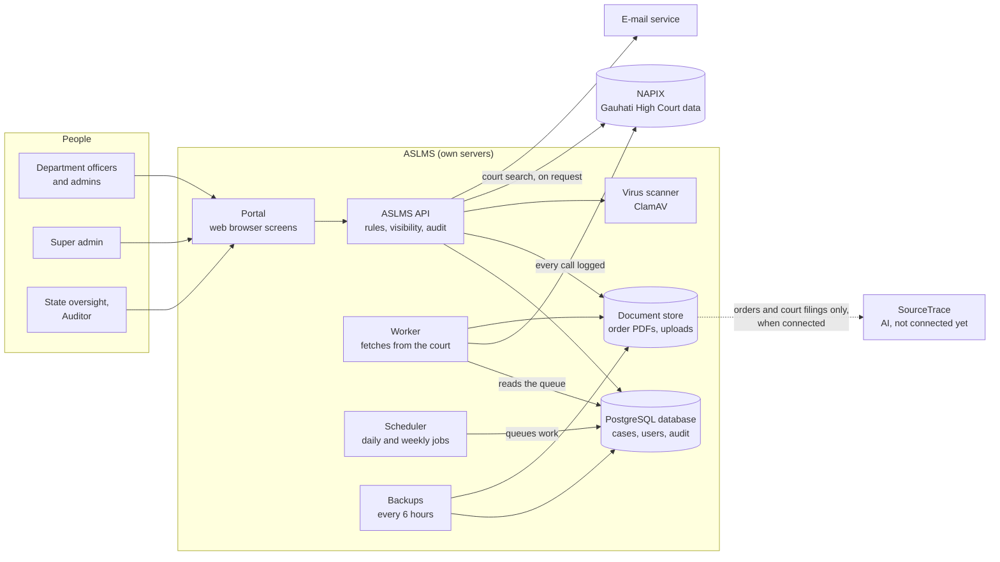
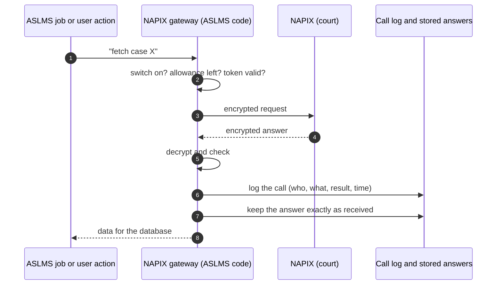
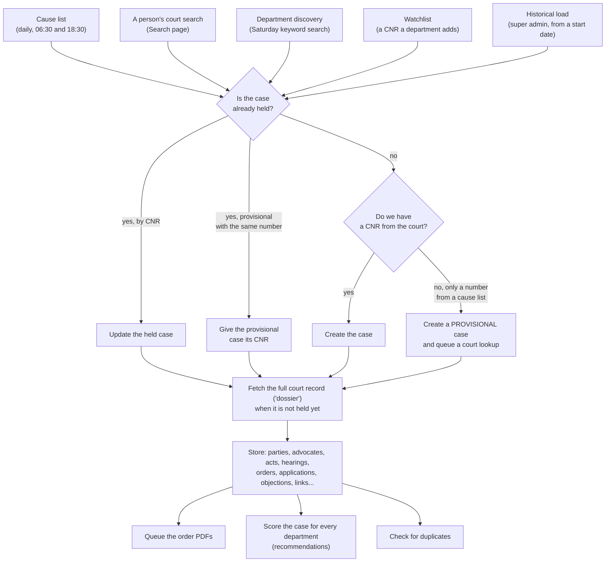
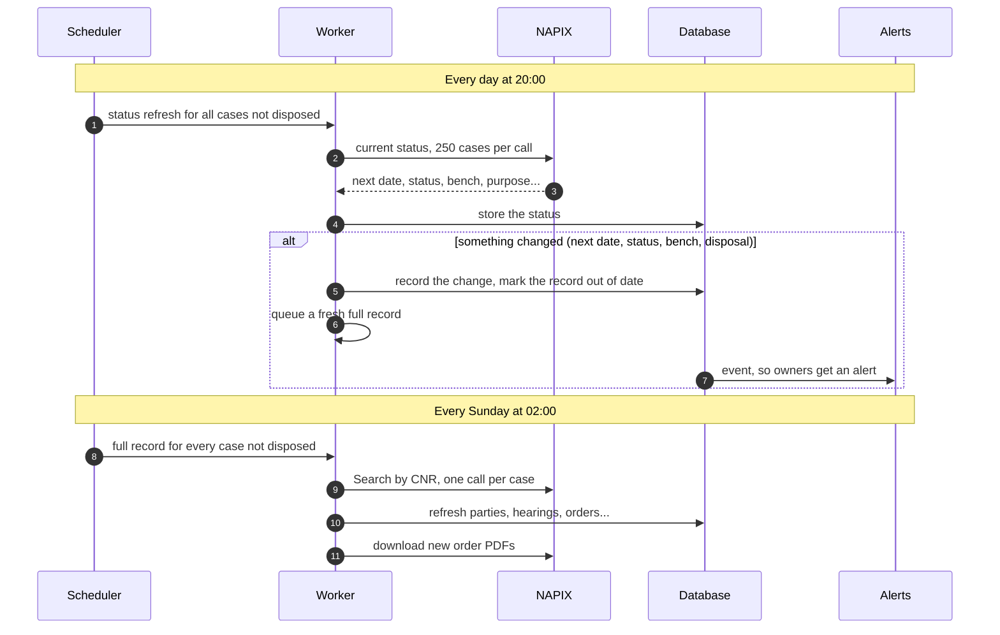
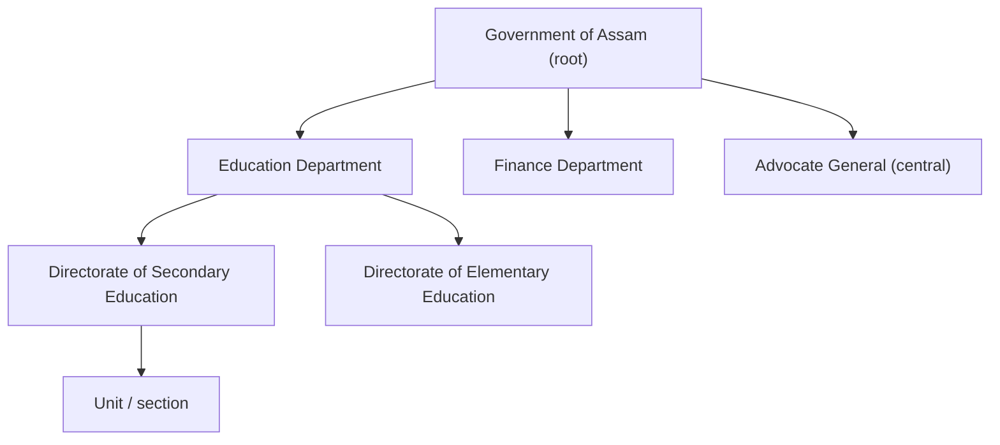
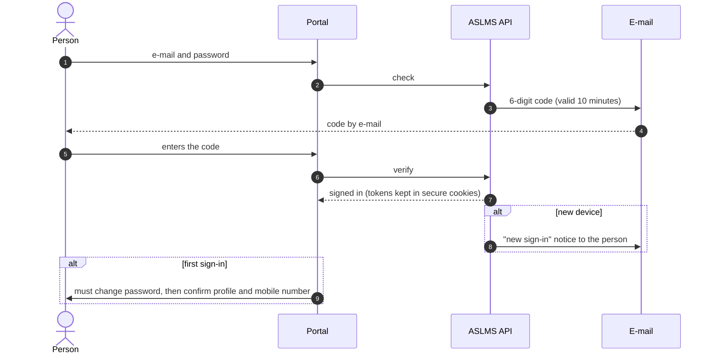
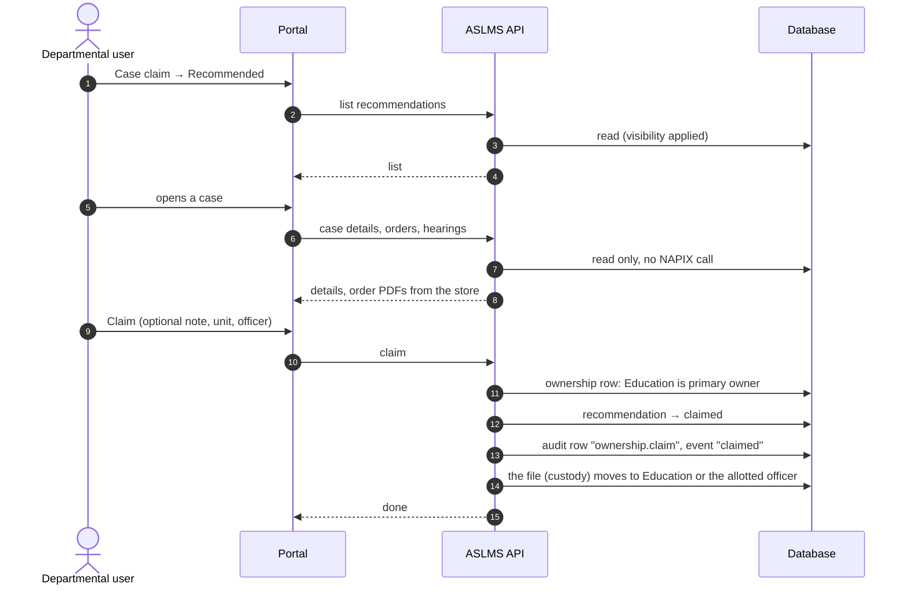
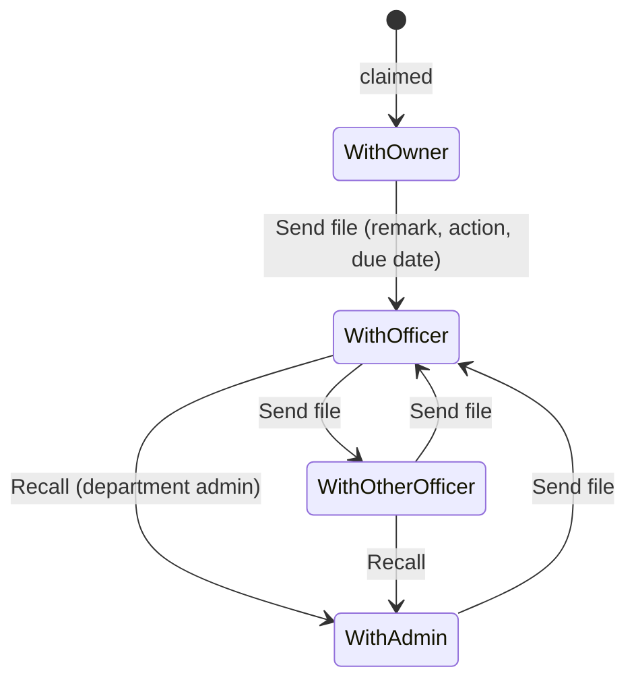
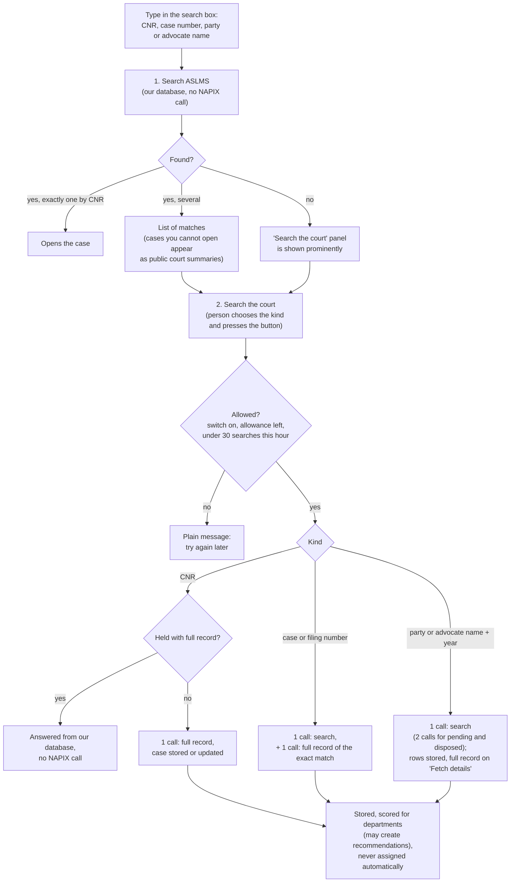

# ASLMS: how the system works

**Assam State Litigation Management System: process workflows and data handling**

| | |
|---|---|
| Owner | SeMT Assam / AMTRON, Government of Assam |
| Describes | The system as built on `main`, 21 October 2026 |
| Readers | The product owner, department and State officials, auditors and anyone asked how ASLMS handles data |
| Status | Living document: updated when a workflow changes |

This document describes what the software **actually does today**. It was written from the code, not from the
plan. Where the code and the plan differ, the code is described and the difference is marked.

How to read it:

- Sections 1 and 2 explain where the data comes from and how it is kept up to date.
- Section 3 explains users, sign-in and who can see what.
- Section 4 walks through the work of each kind of user, step by step.
- Section 5 is a one-page summary of data handling, for questions from officials and auditors.
- Section 6 lists the behaviours worth a decision now. Change them before the pilot if you want them to work differently.

Two kinds of boxes appear throughout:

> ⚙️ **You can change this:** a setting the super admin can change in the application, or a default that is easy
> to change.

> ⚠️ **Worth a decision:** the system works this way today, and it may not be what you expect. Each one is
> repeated in section 6.

---

## Contents

1. [The big picture](#1-the-big-picture)
2. [Where the data comes from: NAPIX](#2-where-the-data-comes-from-napix)
3. [Users, sign-in and who can see what](#3-users-sign-in-and-who-can-see-what)
4. [Walk-throughs by user type](#4-walk-throughs-by-user-type)
5. [Data handling at a glance](#5-data-handling-at-a-glance)
6. [Points worth a decision](#6-points-worth-a-decision)
7. [Glossary](#7-glossary)

---

## 1. The big picture

ASLMS helps Assam government departments track their cases before the Gauhati High Court. The court's data comes
from the **NAPIX** APIs, the official eCourts / High Court interface. ASLMS stores that data in its own database.
Departments then **claim** the cases that are theirs, move the file between officers, write notes, upload filings,
and get alerts before hearings.

### The rules the system never breaks

| Rule | What it means in practice |
|---|---|
| **Recommend and claim** | The system only *recommends* a case to a department. A case belongs to a department only after a person in that department claims it. Once claimed, it never goes back to the unclaimed pool. |
| **NAPIX only through one gateway** | Every call to the court goes through one part of the code. That part handles encryption, the access token, retries and the hourly allowance, and it logs every call. A failed call is recorded, never lost. |
| **A master switch for NAPIX** | `NAPIX_ENABLED` is off by default. Nothing calls the court unless an operator switches it on when the services start. |
| **Every court answer is kept** | Each answer from NAPIX is stored exactly as received, and every field also has a proper place in the database. |
| **No made-up identifiers** | A CNR always comes from the court. A case known only by its number, for example from a cause-list line, is *provisional* until the court confirms its CNR. |
| **Visibility on the server** | The server decides what each person may see, for every request. Hiding something on screen is never the protection. |
| **Notes are append-only** | A note is never edited or deleted. A correction is a new note linked to the old one. |
| **Legal records are never deleted** | Cases, orders, documents and notes are kept. Documents can be archived, not deleted. |
| **Everything significant is audited** | Ownership decisions, file movements, notes, uploads, user and configuration changes all write an audit row. |
| **AI only through SourceTrace** | No other AI service and no local AI model. Only court orders and uploaded court filings may ever go to SourceTrace, never notes or internal documents. It is not connected yet. |

---

## 2. Where the data comes from: NAPIX

### 2.1 How ASLMS talks to the court

ASLMS never scrapes the court website. All court data comes from the NAPIX APIs, through one gateway in the code
(`backend/aslms/integration/napix/`).

- **Access token.** ASLMS signs in to NAPIX with its own credentials, which are kept only in the server's `.env`
  file. It receives a token that lasts about 55 minutes. One token is shared by every part of ASLMS and renewed
  shortly before it expires. If NAPIX rejects a token, ASLMS renews it once and repeats the call.
- **Encryption.** Every request and answer is encrypted the way NAPIX requires.
- **Retries.** If the court's server is busy, a call is tried up to three times with short pauses. Work that still
  fails goes back to the queue (section 2.6).
- **The call log.** Every attempt is a row in `napix_call_log`: which API, when, how long, success or failure, the
  error, and **the user whose action caused it**. Background work records no user.
- **Answers kept as received.** Every successful answer is stored exactly as received in `napix_responses`. Order and
  cause-list PDFs go to the document store.

**The hourly allowance.** NAPIX allows ASLMS about 1,000 calls per hour. The hour does not start on the clock hour,
so ASLMS works out when it resets from its own call log. It keeps a reserve so that people's searches are not
blocked by background work:

| Calls left in the hour | What may run |
|---|---|
| 150 or more | Everything, including the historical load and discovery |
| 100 to 149 | Only people's requests and the daily cycle |
| Fewer than 100 | Nothing from the queue; the worker waits for the reset |
| Fewer than 50 | A person's court search is refused with "try again shortly" |

> ⚙️ **You can change this:** the reserves (`NAPIX_RATE_RESERVE`, `NAPIX_LIVE_RESERVE`, `NAPIX_SEARCH_FLOOR`) and
> each person's limit of 30 court searches an hour are settings in `.env`.

### 2.2 The daily and weekly rhythm

The **scheduler** decides *when* work happens and puts it in a queue. The **worker** does the actual fetching from
NAPIX. All times are Indian Standard Time.

| When | Job | What happens | Calls NAPIX? |
|---|---|---|---|
| 06:00 daily | Court masters | Refreshes the court's reference lists: states, districts, benches, case types, acts | Yes |
| 06:30 and 18:30 daily | Cause lists | Fetches the lists for yesterday, today and tomorrow: benches, list details, the list PDFs. Reads each PDF and records every entry. | Yes |
| 20:00 daily | Status refresh | Asks the court for the current status of every case not yet disposed, 250 cases per call | Yes |
| Every 5 minutes | Order text | Reads the text of newly stored order PDFs and uploads | No |
| Every 5 minutes | Next dates | Reads "list on…" directions in order text (section 4.5) | No |
| Every 5 minutes | Alerts | Turns new events (new order, file received…) into alerts | No |
| Every hour at :10 | Date alerts | Hearing reminders, due and overdue actions; closes alerts whose date has passed | No |
| Every 2 minutes | E-mail | Sends alert e-mails | No |
| 08:00 daily | Digest | Builds and sends each person's daily summary e-mail | No |
| Every 15 minutes | Rescore | Recalculates recommendations, but only if mapping rules or scoring settings changed | No |
| 03:00 daily | Duplicates | Finds and merges duplicate case records | No |
| Saturday 02:00 | Discovery | Searches the court by each department's "search the court" keywords (section 2.5) | Yes |
| Sunday 02:00 | Weekly sweep | Fetches the full record of every case not yet disposed, and of every case never fully fetched; retries missing orders | Yes |
| 00:30, 06:30, 12:30, 18:30 | Backups | Database dump and a copy of the document store | No |
| Sunday 04:30 | Restore check | Restores the latest backup into a scratch database and compares it | No |

### 2.3 How a case enters the database

A case can arrive in five ways. Every path ends at the same step, "find or create the case", which never creates a
second copy of a case already held.

What the **full court record** (the "dossier", from NAPIX *Search by CNR*) fills in:

| Database table | Contents |
|---|---|
| `cases` | Case type, number, year, CNR, filing number, status, court and bench, dates (filing, registration, last and next hearing, disposal), petitioner and respondent summaries, plus the whole answer as received |
| `case_parties`, `case_advocates` | Every party and advocate. Those who leave the court record are marked "not current", never deleted. |
| `case_acts` | Acts and sections |
| `case_hearings` | The court's hearing history |
| `orders` | Every interim and final order and judgment, linked to its PDF once downloaded |
| `case_applications`, `case_objections`, `case_transfers`, `case_writ_info`, `case_links`, `case_lower_courts` | Interlocutory applications, registry objections, transfers, writ details, connected cases, lower-court details |
| `case_snapshots` | Every distinct version of the court record, so changes can be traced |
| `causelist_entries` | Every cause-list line exactly as printed (kept forever, never changed) |
| `documents` + document store | Order PDFs, cause-list PDFs and uploads |

Search results are stored only when they carry a valid CNR. A search row without a CNR is shown to the user but
never stored, so no identifier is ever made up.

### 2.4 How a held case stays up to date

In short:

- **Cases not disposed:** current status **every day**, and a full record **every Sunday** and **whenever the
  status changes**.
- **New orders:** found in the full record. Each new PDF is downloaded in the background, its text is read, and the
  owners get an alert.
- **The next hearing date** comes from the court's own field (`date_next_list`) in the status and the full record.
  Dates read from order text are only suggestions until a person confirms them (section 4.5).
- **A person can ask for a fresh fetch at any time:** "Fetch from court" on a case page, for a case not yet fully
  fetched. Re-fetching a case already fetched is an operator function.

> ⚠️ **Worth a decision:** a case that is **disposed and fully fetched is never refreshed again**. A later order,
> such as a review or restoration, would be missed unless someone fetches it by hand. (Section 6, item 10.)

> ⚠️ **Worth a decision:** claiming a case does **not** make the system fetch it again or refresh it more often. A
> claimed case is refreshed exactly like an unclaimed one. (Section 6, item 1.)

### 2.5 The historical load and department discovery

**The historical load** (Data collection screen, super admin) fills the database with past cause lists, from a start
date the operator chooses (2025-01-01 in development):

- One day at a time, it fetches the cause lists for that day, creates or updates every case listed, then fetches
  each case's full record and its order PDFs.
- It runs only when there is plenty of hourly allowance (150 or more calls left), so it never slows people down.
- The operator can **start**, **pause**, **resume** and choose the **order**: cases first, lists first, or cases
  with their orders.
- Before re-fetching days already held, it asks whether to skip them or fetch them again.

**Department discovery** finds a department's older cases that will not appear in upcoming cause lists:

- A department's keyword or name pattern can be ticked **"Search the court"**.
- Each Saturday the system searches the court by party name for that term, for every year from 2025 to now. A new
  term is searched at once when it is saved.
- Cases found are stored and scored, which may create recommendations. **Nothing is assigned automatically.**
- Discovery uses at most 100 calls per hour, and only when the allowance is high.

### 2.6 The queue: fair order, retries, nothing lost

All court work waits in one queue (`fetch_queue`). Each item has a **priority**, lower numbers first:

| Priority | Work |
|---|---|
| 10 | Court masters |
| 20 | Cause lists for yesterday, today and tomorrow |
| 30 | The daily status refresh, and **requests made by people** |
| 40 | Full records and orders of live cases |
| 41–49 | The historical load and discovery |
| 50 | The weekly sweep |
| 80 | Order PDFs of disposed cases |

**When an item fails**, it is tried again after 10 minutes, then 1 hour, 6 hours, 24 hours and 72 hours. After six
failures it is marked failed and listed under data health. An operator can put it back in the queue. "Not found" and
input errors are not retried.

If the court's server keeps failing, five items in a row, the worker pauses for 5 minutes. An empty answer from the
court is treated as a temporary fault and retried on the same ladder.

### 2.7 What is not fetched, and how long data is kept

- **Not used:** the court's *Show Business* API (the daily business text of each hearing) is used only by the
  System health test. *Act Details*, *Neutral Citation* and *Advocate Bar Registration* are not used.
- **Not stored:** search rows without a valid CNR. Error answers are kept only as short text in the call log.
- **Retention:** nothing is deleted. Cases, orders, documents, notes, the audit log, the call log and every answer
  as received are all kept.

> ⚠️ **Worth a decision:** the call log and the answers as received **grow without limit**. A retention period was
> planned but is not built. (Section 6, item 12.)

---

## 3. Users, sign-in and who can see what

### 3.1 Offices, logins and memberships

- **Offices** form a tree: the State, then departments, then directorates and units. Offices are never deleted, only
  deactivated.
- **A login** belongs to one person, identified by e-mail.
- **A membership** places that login in one office, with a **designation** (from a State-wide list of 18, from Chief
  Secretary to Government Advocate) and a **user type**. One person can hold several memberships, for example in two
  departments, each with its own type.
- Each department has **at most one department head** and **at most one department admin**. There is **one super
  admin** in the whole system.
- A **head of department** is changed through an **admin ticket**: the department admin proposes, the super admin
  approves.
- **When a person leaves an office** (the exit step), every case allotted to them and every file they hold must be
  handed to a named officer first, in one recorded step.

### 3.2 User types and what each can do by default

There are ten user types and 50 active functions. The super admin can grant or withdraw single functions for a
person, and can change the defaults for a whole type.

| User type | What they do by default |
|---|---|
| **Super admin** | Everything: offices, designations, scoring settings, configuration, the type matrix, the historical load, System health, approving tickets, the audit log |
| **Department head** | Sees the whole department. Claims, dismisses, suggests elsewhere, allots, transfers. Searches the court. Moves the file, writes notes, uploads, sets stages. Department reports. |
| **Department admin** | The same as the head, plus: manages the department's users (officers, directorate users, counsel), the department mapping (counsel codes, keywords, watchlist), proposes head changes, **recalls files** |
| **Department officer** | Works on cases allotted to them or files they hold: moves the file, notes, uploads, stages, searches the court, takes over a colleague's case |
| **Directorate user** | Like an officer, within the directorate |
| **Standing counsel** | Sees cases carrying the department's counsel codes. Writes notes and uploads. |
| **Referral reviewer** | Reviews files sent to them, adds notes |
| **State oversight** | Reads every case in the State. State reports and the State dashboard. |
| **Central operator** | Reads every case. Searches the court, suggests a department, keeps the watchlist, operates court data (masters, re-fetch). |
| **Auditor** | Reads every case and the **audit log** |

**Delegation:** a department admin can create users and grant functions only inside their own department, only for
officer, directorate, counsel and reviewer types, and only functions they hold themselves. Every grant is audited.

> ⚙️ **You can change this:** the type matrix (Settings → Administration → Access) and per-person grants. Only the
> super admin changes the matrix.

> ⚠️ **Worth a decision:** by default a **department head cannot recall a file**; only the department admin can.
> The **Auditor can use the Case Assistant**. (Section 6, items 13 and 15.)

### 3.3 Signing in

- **Every sign-in needs the e-mailed code**, on every device. No device skips the second step.
- Ten wrong passwords or codes lock the login for 15 minutes.
- Passwords need at least 10 characters with a letter and a digit, and are stored as a one-way hash (argon2id).
- The portal keeps the sign-in tokens in secure cookies that page scripts cannot read. A session lasts up to 14 days
  of activity. The working token lasts 30 minutes and is renewed silently.
- Forgotten password: a code by e-mail. The answer is the same whether or not the e-mail is registered.
- The super admin can sign a person out everywhere from the command line, and disabling a login ends its sessions.

### 3.4 Who can see which case

The server works out, for every request, why this person may see this case (their **basis**). If they have none,
the case does not exist for them: the answer is "not found", not "forbidden".

**Documents and notes** each carry their own visibility, chosen by the person who adds them:

| Setting | Who sees it |
|---|---|
| Everyone on the case | Everyone who can see the case, except standing counsel, who see only their own |
| Shared with counsel | Everyone on the case, including standing counsel |
| Private to my office | The office, the author, and the department's head and admin |

Court records (orders, cause lists) are open to everyone who can see the case.

> ⚠️ **Worth a decision:** State-wide readers (State oversight, central operator, Auditor) can read **private-to-office
> notes and file remarks** of every department. (Section 6, item 9.)

---

## 4. Walk-throughs by user type

### 4.1 A departmental user is recommended a case and claims it

*The departmental user here is any member of a department who holds the "Claim cases" function: by default
the department head and the department admin, or anyone the administrator grants it to. The Education Department
is used as the example department.*

**Step 1: the system recommends the case.** No person takes part in this step.

When a cause list or a court record arrives, the **matching engine** scores the case for every department. It
looks for these signals:

| Signal | Example | Default weight |
|---|---|---|
| Counsel code on the cause list or in the advocates | "SC, EDU" | 0.95 |
| Name pattern in a party name | "Director of Secondary Education" | 0.80 |
| The department's watchlist | a CNR the department added | 0.75 |
| A linked case the department owns | connected matter | 0.70 |
| Keyword in a party name | "school" | 0.40 |

The signals combine, so several weak signals together make a stronger match. For example, a name pattern plus a
keyword gives 0.88.

| Score | Result |
|---|---|
| 0.85 or more | **Strong recommendation.** An alert goes to the department's claimers. |
| 0.50 to 0.85 | **Possible match.** It appears in the list, with no alert. |
| below 0.50 | No recommendation |

> ⚙️ **You can change this:** the weights and the two thresholds (Settings → Department mapping → Scoring, super
> admin, with a reason and full history). The department's counsel codes, keywords, name patterns and watchlist
> (Department mapping, department admin).

**Step 2: you open Case claim → Recommended.** You see the department's recommendations, strongest first, with the
next hearing date.

**Step 3: you open the case to look at it before claiming.** A large window opens with the case's details, parties,
hearings, orders (each one opens inline, with Print and Download), linked cases, and a box "Why this is suggested"
showing the signals and the score.

**Everything in this window comes from the ASLMS database. Opening it makes no call to NAPIX.** The orders are the
PDFs already downloaded in the background. An order not downloaded yet shows "Fetch pending" or "Not yet published".

**Step 4: you claim.** You may add a note and allot the case to a unit or officer in the same step.

**After the claim:**

- The case is Education's. It appears in **Case inbox → Department cases**, and in **Working on** for the officer it
  is allotted to.
- It can **never return to the unclaimed pool**.
- If another department claims it later through its own recommendation, that department becomes a **watcher**, not
  the owner.
- The case keeps being refreshed by the daily and weekly cycle (section 2.4).

**Instead of claiming, you can:**

- **Dismiss** it. The engine never recommends it to your department again.
- **Suggest another department**, with a reason. It appears in that department's Recommended list.

**The Unclaimed pool** lists cases no department has claimed. Any department head or admin can open them and claim.

> ⚠️ **Worth a decision:**
> - Claiming makes **no fresh NAPIX fetch**. A case known only from a cause-list line stays that way until the
>   weekly sweep, unless someone presses "Fetch from court".
> - The **pool is State-wide**: every department's head and admin can open every unclaimed case.
> - When one department claims, other departments' open recommendations **stay open**.
> - Possible matches, and suggestions from another department, **raise no alert**.
>
> (Section 6, items 1, 5, 6 and 7.)

### 4.2 The department admin organises the work

- **Allot:** give a claimed case to a unit or an officer. That officer gets an alert, and the case appears in their
  **Working on** list.
- **Take over:** an officer of the owning department can take a colleague's case, with no approval. The previous
  officer gets an alert.
- **Transfer to another department:** the owner requests it. The receiving department can see the case while the
  request is open and accepts or declines. On acceptance, ownership moves, and the sender may stay as a watcher.
  Both sides get alerts.
- **Department mapping:** the admin keeps the department's counsel codes (with a panel listing codes seen on cause
  lists that no department has mapped yet), keywords, name patterns and watchlist. Every change is audited and the
  scores are recalculated within 15 minutes.
- **Users:** the admin creates officers, directorate users, counsel and reviewers in the department, and grants them
  functions.

### 4.3 An officer works on a case

- **The file (custody).** Whoever holds the file can **send it** to any officer, in any department. The sender
  writes a remark, chooses a pending action (examine, reply, file, comply, parawise comments…) and may set a due
  date.
  - The receiver gets a "file received" alert.
  - Before the due date the holder gets "due soon"; after it, "overdue", which the department's trackers also see.
  - The department admin can **recall** the file.
  - Moving the file **never changes ownership**.
  - Every move is kept in the file's history.
- **Stage:** the case's stage is set by hand from 24 stages (notice issued, reply filed, appeal…). It is guided, not
  forced. The system never sets a stage itself.
- **Notes:** the holder of the file writes **drafts**, which become permanent when the file moves on. Anyone else's
  note is permanent at once.
  - Visibility is chosen **every time**.
  - Up to 5 files can be attached; they are virus-scanned and never sent to SourceTrace.
  - A note is never edited or deleted. A **correction** is a new note linked to the old one.
- **Documents:** upload a PDF, Word file or image of up to 20 MB.
  - The type is checked from the file's content, not its name.
  - Every file is **virus-scanned before it is stored**; an infected file is refused and the attempt audited.
  - Each document has its own visibility. Documents can be archived, never deleted.
  - Downloads of uploaded files are audited.
- **The case page** shows a summary header and tabs: Overview, Hearings, Orders, Documents, Notes, Timeline, and
  More (Parties, Linked cases, Custody and stage, Alerts, Details). **All of it is read from the database. Opening a
  case page never calls NAPIX.**

> ⚠️ **Worth a decision:** adding a note and setting a stage **raise no alert** to others on the case. (Section 6,
> item 8.)

### 4.4 Searching for a case

The Search page has **two separate searches**. The first never calls the court. The second does, and only when the
person presses its button.

- **Search ASLMS** reads only our database. A CNR, an ASLMS reference or a case number is matched exactly. Words
  are matched against parties and advocates. Filters are available, and a separate tab searches the **text of
  orders and documents**.
- **Search the court** needs the "search the court" function: department heads, admins, officers and the central
  operator have it by default. The person picks CNR, case number, filing number, party name or advocate name.
  - A **held case that already has its full record** is answered from our database, with no NAPIX call.
  - A **held case without its full record** is **updated in place**, never duplicated.
  - Results are **stored**, so the next person finds them with a plain ASLMS search.
  - Every court search is audited: who, what, how many calls, how many results.
  - Large advocate searches store the first 25 cases at once and the rest in the background, up to 300.

> ⚠️ **Worth a decision:** this differs from the idea "search our database, and if it is not there, search the
> court". Today the person **chooses** to search the court. The system does not fall back on its own. This was
> decided earlier so that court calls are always deliberate. A search the database answers still counts towards the
> person's 30 per hour. (Section 6, items 2 and 3.)

### 4.5 Hearings, next dates, alerts and the calendar

**Where hearing dates come from:**

1. The court's own next date, from the daily status and the full record.
2. Cause-list listings.
3. Dates read from order text. These are only **suggestions** until confirmed.

**Next dates from orders.** Every 5 minutes the system reads new order text by fixed rules, with no AI. It looks for
directions such as "list on 12.11.2026" or "list after four weeks".

- If the date it reads **equals the court's own date or a cause-list listing**, it is firm.
- Otherwise it is a **suggestion**. An officer working on the case confirms it, rejects it (with a replacement date
  if needed) or enters the date by hand.
- A period such as "after four weeks" is calculated from the order date and always shown for confirmation.

**Alerts** go to the people working on the case, in the portal's bell and by e-mail:

| Event | Alert |
|---|---|
| Hearing in the next 7 days | High. **Critical** within 48 hours. |
| New order stored | Yes |
| Next date changed, status changed, disposed | Yes |
| File received, file recalled | To the person concerned |
| Action due soon or overdue | Due soon is high, overdue is critical; also to the department's trackers |
| Strong recommendation | To the department's claimers |
| Allotted, taken over, transfer requested or decided | To the people concerned |
| A next date to confirm | To the officers working on the case |

- **E-mail:** critical alerts are sent at once. The rest come in a **daily digest** at 08:00, which also lists the
  next 7 days' hearings. Each person can change their preferences. E-mails never contain note text or document names.
- **Alerts only for owned cases.** Case alerts are raised only for cases a department owns or watches, and only for
  court dates in the next 14 days, so the historical load does not flood anyone.
- **My calendar** shows my hearings, the due dates of files I hold, and next dates waiting for my confirmation.
  **Department hearings** shows the whole department.
- **The Cause list screen** shows any date and bench in court order, with each entry's recommendation or owner, a
  **Claim** button and the original PDF.

### 4.6 The super admin runs the system

| Area | What the super admin does |
|---|---|
| Offices and designations | Creates departments with their head, directorates, units and designations |
| Users and access | Creates department admins, changes the type matrix, grants single functions, approves head-change tickets |
| Department mapping | Everything a department admin does, for any department. Plus the **scoring weights and thresholds**, and the generic State counsel codes. |
| Data collection | Starts, pauses and orders the historical load. Fetches single cases. Sees duplicates, the queue and discovery. |
| System health | Watches the 17 court APIs and ten ASLMS services. "Test now" makes one live court call, limited and audited. |
| Audit log | Searches every audited action, with before-and-after values |
| Reports | All four reports, State-wide, with Excel and PDF export (exports are audited) |

### 4.7 State oversight and the Auditor

- **State oversight** reads every case, the State dashboard (one row per department, the unclaimed count, hearings,
  overdue actions) and State reports. They cannot claim or change anything.
- **The Auditor** reads every case and the **audit log**: who did what and when, with before-and-after values and
  links from each case, person and record. Reading the audit log is not itself audited.

### 4.8 Standing counsel

Standing counsel see the cases that carry their department's counsel code, on a cause list or in the advocates. They
can write notes and upload documents. They see notes and documents marked "shared with counsel", and their own.

---

## 5. Data handling at a glance

*For questions such as "where does your data come from, where is it kept, who can see it?"*

| Question | Answer |
|---|---|
| **Where does the court data come from?** | Only from the official NAPIX APIs of the eCourts / Gauhati High Court, using ASLMS's own credentials. No website scraping. |
| **What court data do we keep?** | Public court records: cause lists, case details (parties, advocates, acts, hearings), orders and judgments. Every answer is also kept exactly as received. |
| **What do users add?** | Ownership decisions, file movements with remarks, notes, uploaded documents, stages, confirmed dates. |
| **Where is it stored?** | On ASLMS's own servers: a PostgreSQL database and a document store. Nothing is kept in a public cloud service. |
| **Who can see it?** | Decided by the server for every request, by office and role (section 3.4). Each note and document has its own visibility. A case a person may not see does not appear at all. |
| **How do people sign in?** | Password plus a 6-digit code by e-mail at every sign-in. Lock-out after repeated failures. Passwords stored only as a one-way hash. |
| **Is every action recorded?** | Yes. Ownership decisions, file movements, notes, uploads, downloads of uploaded files, user and access changes, configuration changes, court searches, exports and sign-ins write audit rows that cannot be changed. |
| **Is every call to the court recorded?** | Yes: which API, when, the result, and the person whose action caused it. The record is kept even if the request fails. |
| **Are uploads checked?** | Type checked from content (PDF, Word, images), 20 MB limit, virus scan before anything is stored. |
| **Is anything deleted?** | No legal record is deleted. Documents can be archived. Corrections to notes are new notes. |
| **Backups?** | Every 6 hours (database and documents), with a weekly automatic restore test. |
| **Is any data sent to an AI?** | Not today. When SourceTrace is connected, only court orders and uploaded court filings may be sent: never notes, internal documents, attachments or file remarks. This is enforced in three places, including the database. |
| **What do e-mails contain?** | Case numbers, dates and the kind of alert. Never note text or document names. |
| **Where are secrets kept?** | Only in the server's `.env` file. Never in the code, the database, the logs or the GitHub repository. |

---

## 6. Points worth a decision

These came out of reading the code for this document. Each one is how the system works **today**. None is a fault
against the plan, but some may not be what you want. Tell me which to change, and each becomes a backlog item with a
design for your approval.

**About claiming and recommendations**

1. **Claiming does not fetch fresh court data.** A claimed case is not refreshed sooner or more often than any other.
   *Option:* on claim, queue a full court record at once (request priority) when the case has none or it is more
   than a day old.
2. **Search does not fall back to the court automatically.** The person chooses "Search the court". *Option:* keep
   it as it is (deliberate calls), or search the court automatically when the local search finds nothing and the
   person holds the function.
3. **A court search answered from our database still counts** towards the person's 30 per hour, and is refused while
   NAPIX is switched off. *Option:* answer held cases even with NAPIX off, without counting them.
4. **The ASLMS search lists cases the person cannot open**, as public court summaries, unless "Only cases I can open"
   is ticked. *Option:* tick it by default.
5. **The unclaimed pool is State-wide.** Every department's head and admin can open every unclaimed case. *Option:*
   limit the pool to cases with some signal for the department, and let the central operator see everything.
6. **Other departments' recommendations stay open after a claim.** They can still claim and become watchers.
   *Option:* expire them on claim and tell those departments.
7. **Possible matches never raise an alert**, and a suggestion from another department arrives as a possible match,
   so the suggested department gets no alert. *Option:* alert on human suggestions always.

**About alerts and visibility**

8. **No alert when someone claims a case, adds a note or sets a stage**, and no separate "newly listed" alert (a
   listing appears as a hearing reminder up to 7 days ahead). *Option:* add a "new note on your case" alert, and a
   "listed for tomorrow" alert from the evening cause list.
9. **State-wide readers see private-to-office notes and file remarks** of every department. *Option:* hide
   private-to-office notes from State oversight and the central operator, and keep them for the Auditor.

**About court data**

10. **Disposed cases are never refreshed again** once fully fetched. *Option:* refresh disposed cases monthly for
    one year after disposal.
11. **A corrected cause list re-issued under the same list number is not fetched again.** *Option:* re-fetch
    today's and tomorrow's lists at 18:30, even if already read.
12. **No retention period for the call log and the answers as received.** They grow without limit. *Option:* keep
    the call log for 2 years and the answers as received for as long as the case lives. Your decision, since it is a
    records question.

**About roles**

13. **A department head cannot recall a file by default**; only the department admin can. *Option:* give recall to
    the head too.
14. **Only the super admin can create directorates and units.** *Option:* let the department admin create them
    inside the department.
15. **The Auditor has the Case Assistant by default.** *Option:* remove it from the Auditor.
16. **Signing out ends the session, but a working token already issued stays valid for up to 30 minutes.** *Option:*
    shorten the working token to 10 minutes, or keep a revocation list. This is technical; I recommend leaving it
    until after the pilot.

**Technical gaps noted** (no decision needed; they go to the backlog as fixes):

- On a busy day the daily status batches can skip or repeat a few cases, because the batches are worked out when they
  run.
- One diagnostic command (`aslms napix-probe-rate`) does not write its calls to the call log.
- Job dates use the container's UTC clock, so a 03:00 IST job is dated the previous day.
- After the latest change, 15 or more simultaneous court searches could exhaust the API's database connections
  (backlog row 114).

---

## 7. Glossary

| Term | Meaning |
|---|---|
| **CNR** | Case Number Record: the court's unique 16-character identifier, for example `ASHC010012342025` |
| **Provisional case** | A case known only by its number, for example from a cause-list line, whose CNR the court has not yet confirmed |
| **Dossier / full court record** | The complete case data from NAPIX *Search by CNR*: parties, advocates, acts, hearings, orders and more |
| **Cause list** | The court's daily list of cases to be heard, per bench |
| **Recommendation** | The system's suggestion that a case belongs to a department, with a score |
| **Claim** | A department taking ownership of a case. Only a person can do this. |
| **Primary owner / watcher** | The department that owns the case, and other departments following it |
| **Allot** | Giving a claimed case to a unit or officer inside the department |
| **Custody / the file** | Who currently holds the case file to act on it |
| **Membership** | A person's place in one office, with a designation and user type |
| **Function** | A single permission, such as "claim cases" or "search the court" |
| **NAPIX** | The official eCourts API gateway through which ASLMS reads High Court data |
| **SourceTrace** | The AI service for the Case Assistant. Not connected yet. |
| **Hourly allowance** | The number of NAPIX calls ASLMS may make per hour (about 1,000) |
